# Índice

* [Descripción de la prueba](#descripción-de-la-prueba)
* [Solución aplicada](#solución-aplicada)
* [Arquitectura de la solución](#arquitectura-de-la-solución)
  * [Pre-requisitos](#pre-requisitos)
  * [Creación del proyecto](#creación-del-proyecto)
  * [Instalación de las dependencias](#instalación-de-las-dependencias)
  * [Funcionalidad desarrollada](#funcionalidad-desarrollada)
  * [Descripción de las pruebas de la funcionalidad desarrollada](#descripción-de-las-pruebas-de-la-funcionalidad-desarrollada)
  * [Ejecución de las pruebas de la funcionalidad desarrollada](#ejecución-de-las-pruebas-de-la-funcionalidad-desarrollada)
  * [Diferencias entre el comportamiento entre los almacenamientos overwrite, append y merge](#diferencias-entre-el-comportamiento-entre-los-almacenamientos-overwrite-append-y-merge)
    * [test_informe_overwrite_append_merge_CSV_1_registro](#test_informe_overwrite_append_merge_csv_1_registro)
    * [test_informe_overwrite_append_merge_CSV_REDUCIDOS](#test_informe_overwrite_append_merge_csv_reducidos)
  * [Obtener un informe del porcentaje de cobertura de código en las pruebas](#obtener-un-informe-del-porcentaje-de-cobertura-de-código-en-las-pruebas)
* [Infraestructura as code y workflows CI / CD](#infraestructura-as-code-y-workflows-ci--cd)

---

# Descripción de la prueba

El objetivo de la prueba técnica es que puedas demostrar tus capacidades de desarrollo en el marco de Big Data y Spark,
además de los conceptos básicos del ciclo de vida de data engineering.

Somos conscientes de que algunos de los componentes tecnológicos que proponemos para esta prueba técnica quizá no los conozcas,
pero pensamos que por tus capacidades podrás adquirir un conocimiento básico en estos días para sacar adelante la prueba.

Los puntos a tratar en la prueba técnica serían los siguientes:

1. Descomprimir el fichero assets.zip recibido junto con este documento.
2. Deberás desarrollar un programa basado en Python (preferentemente) o Scala que haga lo siguiente:

__Descripción del programa__:

El programa realizado en Python (preferentemente) o Scala debería, dirigido por el fichero de metadatos “metadata.json”,
ejecutar un proceso que lea datos desde los orígenes descritos, ejecute las transformaciones indicadas y escriba los datos en los destinos especificados.

Es muy importante que sea un programa que cambie su comportamiento dinámicamente vía los metadatos propuestos y que no sea un desarrollo ad hoc.

**Nota**: Entiendo que la solución esperada no es un bloque similar a este, sino un código genérico que interpreta y ejecuta
cualquier variante del json proporcionado:

```shell

  df_transformado = df
                .filter("sexo != 'Ambos sexos' and municipio != 'N/A'")
                .withColumn("domain", F.lit("demography"))
                .withColumn("load_date", F.current_date())
                .groupBy("provincia", "municipio", "sexo", "load_date")
                .agg(F.sum("total").alias("total_ambos_sexos"))
```

**__Observación__** sin quitar un gramo de valor al ejercicio propuesto, quizás la columna `total_ambos_sexos` podría renombrarse a `total_por_sexo` para ajustarse de forma más precisa a la agrupación que estamos haciendo, ya que al incluir el sexo en esta, en realidad estamos sumando el total de cada sexo por separado. 

3. Este código tiene que ser compilado y ejecutado usando el csv “data2024.csv” como datos de entrada 
4. Después de la primera ejecución, se pide volver a ejecutar usando el csv “data2025.csv”.

Es necesario demostrar el comportamiento solicitado en las salidas (overwrite, append y merge).

5. Adicionalmente, se piden 2 códigos (totalmente aparte del punto 1) para realizar las siguientes comprobaciones (por ejemplo, un test unitario):

    a. Qué filas han cambiado del fichero de 2024 al fichero de 2025

    b. Qué problemas de calidad del dato tiene el fichero de 2025 (Ambos sexos != Hombres + Mujeres)

6. Como ultimo punto, se pide que en un documento de PowerPoint se haga una presentación de cómo se podría implantar un motor como el solicitado
(suponiendo funcionalidades extendidas de lectura, transformacion y escritura, no únicamente las solicitadas en esta prueba)
en una arquitectura de datos basada en alguna de las clouds más habituales (Azure, Google, AWS, Cloudera).

Ese diseño debe incluir un **Airflow** como orquestador, ademas del resto de servicios necesarios para industrializar
una solución de este tipo (bases de datos, storages, etc...).

Incluir también los ciclos de CI/CD correspondientes para realizar el despliegue de todos los componentes de software que fueran necesarios.

En este documento no es necesario explicar ni exponer nada sobre la creación y despliegue de los servicios en cloud mediante IaC
(infraestructure as code).

Si tienes que priorizar en qué te enfocas de la prueba técnica porque no tienes suficiente tiempo, el principal objetivo es
que nos desmuestres tus capacidades de Python/Scala y Spark.

Así que nos gustaría indicarte que el framework de procesamiento dirigido por metadatos que diseñes e implementes es en lo
que más vamos a valorar en términos técnicos y en términos de presentación.

# Solución aplicada

Para mi solución he hecho esta selección:

* pyspark
* PyCharm como IDE
* [uv](https://docs.astral.sh/uv/)
* Cloud AWS y estos componentes:
  * [AWS EMR](https://docs.aws.amazon.com/es_es/emr/latest/ManagementGuide/emr-what-is-emr.html) para el cluster de Spark y Hadoop.
    * [AWS DynamoDB](https://aws.amazon.com/es/dynamodb/) como base de datos de destino cuando out_type == "table",
      ya que en DynamoDB un put_item funciona de manera nativa como un upsert, creando el elemento si no existe o
      sobreescribiéndolo si la clave primaria coincide.

      Para ilustrar mejor las diferencias entre append he pensado utilizar claves compuestas; de no hacerlo así o de un modo similar,
      las fílas se sobreescribirían y no veríamos cómo crece el número de líneas cambios tras las distintas ejecuciones. Lo veremos
      en detalle durante la sesión de test.
    
      * para append en la tabla `demo`, utilizaremos una clave sort key compuesta con los campos municipio, sexo y load_date: 
  
        ```shell
        dynamodb_client.create_table(
            TableName="demo",
            KeySchema=[
                {"AttributeName": "provincia", "KeyType": "HASH"},
                {"AttributeName": "municipio_sexo_date", "KeyType": "RANGE"}
            ],
            AttributeDefinitions=[
                {"AttributeName": "provincia", "AttributeType": "S"},
                {"AttributeName": "municipio_sexo_date", "AttributeType": "S"}
            ],
            BillingMode="PAY_PER_REQUEST"
        )
         ```

        * para merge en la tabla `raw_demo`, utilizaremos una clave sort key compuesta con los campos municipio y sexo: 
  
          ```shell
         dynamodb_client.create_table(
            TableName="raw_demo",
            KeySchema=[
                {"AttributeName": "provincia", "KeyType": "HASH"},
                {"AttributeName": "municipio_sexo", "KeyType": "RANGE"}
            ],
            AttributeDefinitions=[
                {"AttributeName": "provincia", "AttributeType": "S"},
                {"AttributeName": "municipio_sexo", "AttributeType": "S"}
            ],
            BillingMode="PAY_PER_REQUEST"
        )   
         ```
  
      

  * [AWS S3](https://aws.amazon.com/es/s3/) como sistema de almacenamiento de archivos para guardar los CSV, el archivo 
    metadata.json y los archivos resultantes de la transformación cuando out_type == "file".
  * [AWS Secrets Manager](https://aws.amazon.com/es/secrets-manager) para almacenar y recuperar las credenciales de acceso
    al cluster de EMR.
  * [AWS Managed Workflows para Apache Airflow (MWAA)](https://aws.amazon.com/es/managed-workflows-for-apache-airflow/)


# Arquitectura de la solución

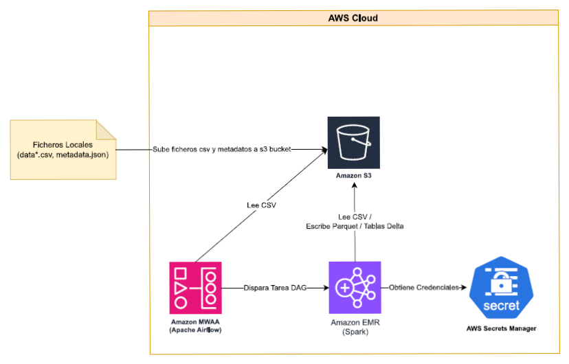

## Pre-requisitos

º JDK version 17 o superior. He elegido la 17 porque es la que tengo instalada en mi portátil:

```shell
C:\Users\user>java --version
openjdk 17.0.20 2026-07-21
OpenJDK Runtime Environment Temurin-17.0.20+8 (build 17.0.20+8)
OpenJDK 64-Bit Server VM Temurin-17.0.20+8 (build 17.0.20+8, mixed mode, sharing)
```

__Nota__

Utilizo JDK Eclipse Temurin porque es la recomendada en en desarrollo para ecosistemas de Big Data y Spark por estos motivos:

► A diferencia de Oracle JDK, es gratuita.

► Su adopción está muy extendida y testada en entornos productivos cloud y on premises.

► Es estable y tiene soporte a largo plazo.

► Es compatible con Apache Spark y está optimizada para integrarse de modo transparente con las dependencias de este lenguaje con la máquina virtual de Java, de modo que experimentaremos muchos menos problemas de compatibilidad que si usamos otro vendedor como Oracle.

º Setup the local HADOOP_HOME configuration:

https://github.com/cdarlint/winutils/tree/master/hadoop-3.3.6/bin

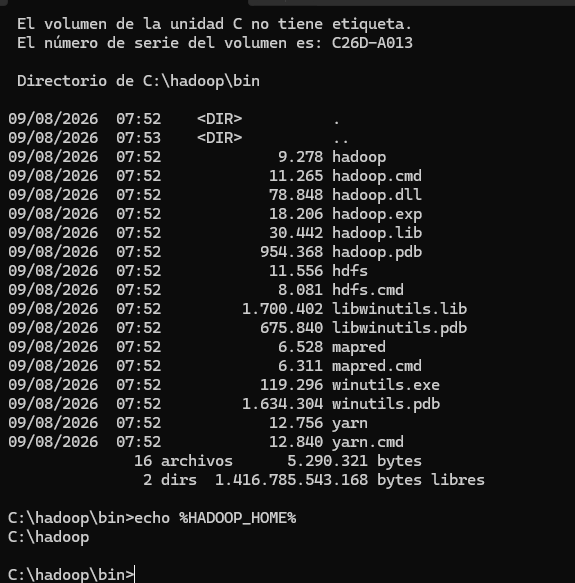

## Creación del proyecto

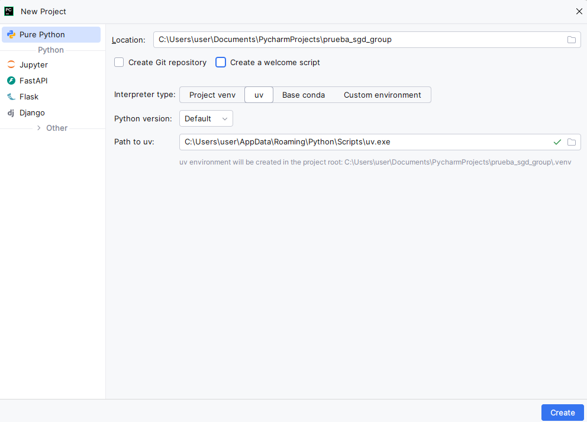

## Instalación de las dependencias

Añado una versión de pyspark compatible con la máquina virtual de Java 17 y la versión de python que uso en mi sistema:

```shell
(prueba_sgd_group) PS C:\Users\user\Documents\PycharmProjects\prueba_sgd_group> uv add "pyspark>=3.5,<4.0"
Resolved 3 packages in 2m 56s
      Built pyspark==3.5.9                                                                                                                                                                                                          
      Built prueba-sgd-group @ file:///C:/Users/user/Documents/PycharmProjects/prueba_sgd_group                                                                                                                                     Prepared 2 packages in 13.39s
Uninstalled 1 package in 2ms
Installed 3 packages in 323ms
 ~ prueba-sgd-group==0.1.0 (from file:///C:/Users/user/Documents/PycharmProjects/prueba_sgd_group)
 + py4j==0.10.9.9
 + pyspark==3.5.9  
```

```shell
(prueba_sgd_group) PS C:\Users\user\Documents\PycharmProjects\prueba_sgd_group> uv add "pandas>=2.0.0"    
Resolved 9 packages in 1.01s
      Built prueba-sgd-group @ file:///C:/Users/user/Documents/PycharmProjects/prueba_sgd_group                                                                                                                                     
Prepared 6 packages in 7.29s
Uninstalled 1 package in 1ms
Installed 6 packages in 468ms
 + numpy==2.4.6
 + pandas==3.0.5
 ~ prueba-sgd-group==0.1.0 (from file:///C:/Users/user/Documents/PycharmProjects/prueba_sgd_group)
 + python-dateutil==2.9.0.post0
 + six==1.17.0
 + tzdata==2026.3
```

```shell
(prueba_sgd_group) PS C:\Users\user\Documents\PycharmProjects\prueba_sgd_group> uv add delta-spark
Resolved 12 packages in 528ms
      Built prueba-sgd-group @ file:///C:/Users/user/Documents/PycharmProjects/prueba_sgd_group                                                                                                                                     
Prepared 4 packages in 85ms
Uninstalled 1 package in 3ms
Installed 4 packages in 34ms
 + delta-spark==3.3.2
 + importlib-metadata==9.0.0
 ~ prueba-sgd-group==0.1.0 (from file:///C:/Users/user/Documents/PycharmProjects/prueba_sgd_group)
 + zipp==4.1.0
```

```shell
(prueba_sgd_group) PS C:\Users\user\Documents\PycharmProjects\prueba_sgd_group> uv add apache-airflow
Resolved 137 packages in 1.72s
      Built prueba-sgd-group @ file:///C:/Users/user/Documents/PycharmProjects/prueba_sgd_group                                                                                                                                     
Prepared 124 packages in 5.66s
Uninstalled 1 package in 2ms
Installed 124 packages in 833ms
 + a2wsgi==1.10.10
 + aiosmtplib==5.1.2
 + aiosqlite==0.21.0
 + alembic==1.19.1
 + annotated-doc==0.0.5
 + annotated-types==0.8.0
 + anyio==4.14.2
 + apache-airflow==3.3.0
 + apache-airflow-core==3.3.0
 + apache-airflow-providers-common-compat==1.18.0
 + apache-airflow-providers-common-io==1.8.0
 + apache-airflow-providers-common-sql==2.1.0
 + apache-airflow-providers-smtp==3.0.3
 + apache-airflow-providers-standard==1.17.0
 + apache-airflow-task-sdk==1.3.0
 + argcomplete==3.7.2
 + arrow==1.4.0
 + asgiref==3.12.1
 + attrs==26.1.0
 + babel==2.18.0
 + cachetools==7.1.7
 + cadwyn==7.0.0
 + certifi==2026.7.22
 + cffi==2.1.1
 + charset-normalizer==3.4.9
 + click==8.4.2
 + colorama==0.4.6
 + colorlog==6.12.0
 + cron-descriptor==2.1.0
 + croniter==6.2.4
 + cryptography==50.0.0
 + deprecated==1.3.1
 + dill==0.4.1
 + dnspython==2.8.0
 + email-validator==2.3.0
 + fastapi==0.136.3
 + fastapi-cli==0.0.32
 + fsspec==2026.7.0
 + googleapis-common-protos==1.75.1
 + greenback==1.3.0
 + greenlet==3.5.5
 + grpcio==1.83.0
 + h11==0.16.0
 + httpcore==1.0.9
 + httptools==0.8.0
 + httpx==0.28.1
 + idna==3.18
 + isoduration==20.11.0
 + itsdangerous==2.2.0
 + jinja2==3.1.6
 + jsonschema==4.26.0
 + jsonschema-specifications==2025.9.1
 + lazy-object-proxy==1.12.0
 + libcst==1.9.0
 + linkify-it-py==2.1.0
 + lockfile==0.12.2
 + mako==1.4.1
 + markdown-it-py==4.2.0
 + markupsafe==3.0.3
 + mdurl==0.1.2
 + methodtools==0.4.7
 + more-itertools==11.1.0
 + msgspec==0.21.1
 + natsort==8.4.0
 + opentelemetry-api==1.44.0
 + opentelemetry-exporter-otlp==1.44.0
 + opentelemetry-exporter-otlp-proto-common==1.44.0
 + opentelemetry-exporter-otlp-proto-grpc==1.44.0
 + opentelemetry-exporter-otlp-proto-http==1.44.0
 + opentelemetry-proto==1.44.0
 + opentelemetry-sdk==1.44.0
 + opentelemetry-semantic-conventions==0.65b0
 + outcome==1.3.0.post0
 + packaging==26.3
 + pathlib-abc==0.5.2
 + pathspec==1.1.1
 + pendulum==3.2.0
 + pluggy==1.6.0
 + protobuf==7.35.1
 ~ prueba-sgd-group==0.1.0 (from file:///C:/Users/user/Documents/PycharmProjects/prueba_sgd_group)
 + psutil==7.2.2
 + pycparser==3.0
 + pydantic==2.13.4
 + pydantic-core==2.46.4
 + pydantic-extra-types==2.11.1
 + pydantic-settings==2.15.0
 + pygments==2.20.0
 + pygtrie==2.5.0
 + pyjwt==2.13.0
 + python-daemon==3.1.2
 + python-dotenv==1.2.2
 + python-multipart==0.0.32
 + python-slugify==8.0.4
 + pyyaml==6.0.3
 + referencing==0.37.0
 + requests==2.34.2
 + rich==15.0.0
 + rich-argparse==1.8.0
 + rich-toolkit==0.20.3
 + rpds-py==2026.6.3
 + setproctitle==1.3.7
 + shellingham==1.5.4
 + sniffio==1.3.1
 + sqlalchemy==2.0.52
 + sqlparse==0.5.5
 + starlette==1.6.0
 + structlog==26.1.0
 + svcs==26.1.0
 + tabulate==0.10.0
 + tenacity==9.1.4
 + termcolor==3.3.0
 + text-unidecode==1.3
 + typer==0.27.1
 + typing-extensions==4.16.0
 + typing-inspection==0.4.3
 + uc-micro-py==2.0.0
 + universal-pathlib==0.3.10
 + urllib3==2.7.0
 + uuid6==2025.0.1
 + uvicorn==0.52.1
 + watchfiles==1.2.0
 + websockets==17.0.1
 + wirerope==1.0.0
 + wrapt==2.3.0
```

```shell
(prueba_sgd_group) PS C:\Users\user\Documents\PycharmProjects\prueba_sgd_group> uv add pytest        
Resolved 139 packages in 537ms
      Built prueba-sgd-group @ file:///C:/Users/user/Documents/PycharmProjects/prueba_sgd_group                                                                                                                                     
Prepared 3 packages in 117ms
Uninstalled 1 package in 2ms
Installed 3 packages in 52ms
 + iniconfig==2.3.0
 ~ prueba-sgd-group==0.1.0 (from file:///C:/Users/user/Documents/PycharmProjects/prueba_sgd_group)
 + pytest==9.1.1
(prueba_sgd_group) PS C:\Users\user\Documents\PycharmProjects\prueba_sgd_group> uv add pytest-mock
Resolved 140 packages in 272ms
      Built prueba-sgd-group @ file:///C:/Users/user/Documents/PycharmProjects/prueba_sgd_group                                                                                                                                     
Prepared 2 packages in 83ms
Uninstalled 1 package in 2ms
Installed 2 packages in 21ms
 ~ prueba-sgd-group==0.1.0 (from file:///C:/Users/user/Documents/PycharmProjects/prueba_sgd_group)
 + pytest-mock==3.15.1
(prueba_sgd_group) PS C:\Users\user\Documents\PycharmProjects\prueba_sgd_group> uv add pytest-cov 
Resolved 143 packages in 527ms
      Built prueba-sgd-group @ file:///C:/Users/user/Documents/PycharmProjects/prueba_sgd_group                                                                                                                                     
Prepared 3 packages in 254ms
Uninstalled 1 package in 2ms
Installed 3 packages in 55ms
 + coverage==7.15.4
 ~ prueba-sgd-group==0.1.0 (from file:///C:/Users/user/Documents/PycharmProjects/prueba_sgd_group)
 + pytest-cov==7.1.0
(prueba_sgd_group) PS C:\Users\user\Documents\PycharmProjects\prueba_sgd_group> uv add moto      
Resolved 151 packages in 492ms
      Built prueba-sgd-group @ file:///C:/Users/user/Documents/PycharmProjects/prueba_sgd_group                                                                                                                                     
Prepared 9 packages in 2.23s
Uninstalled 1 package in 1ms
Installed 9 packages in 781ms
 + boto3==1.43.69
 + botocore==1.43.69
 + jmespath==1.1.0
 + moto==5.2.2
 ~ prueba-sgd-group==0.1.0 (from file:///C:/Users/user/Documents/PycharmProjects/prueba_sgd_group)
 + responses==0.26.2
 + s3transfer==0.19.2
 + werkzeug==3.1.8
 + xmltodict==1.0.4

(prueba_sgd_group) PS C:\Users\user\Documents\PycharmProjects\prueba_sgd_group> uv add boto3-stubs
Resolved 154 packages in 889ms
      Built prueba-sgd-group @ file:///C:/Users/user/Documents/PycharmProjects/prueba_sgd_group                                                                                                                                    
Prepared 4 packages in 118ms
Uninstalled 1 package in 4ms
Installed 4 packages in 35ms
 + boto3-stubs==1.43.69
 + botocore-stubs==1.43.67
 ~ prueba-sgd-group==0.1.0 (from file:///C:/Users/user/Documents/PycharmProjects/prueba_sgd_group)
 + types-s3transfer==0.16.0
 
(prueba_sgd_group) PS C:\Users\user\Documents\PycharmProjects\prueba_sgd_group> uv pip install "apache-airflow>=2.8.0,<3.0.0" "apache-airflow-providers-amazon>=8.0.0"
Resolved 158 packages in 232ms
Uninstalled 5 packages in 47ms
Installed 5 packages in 315ms
 - apache-airflow==3.3.0
 + apache-airflow==2.11.2
 - marshmallow==4.3.1
 + marshmallow==3.26.2
 - rich==15.0.0
 + rich==13.9.4
 - sqlalchemy==2.0.52
 + sqlalchemy==1.4.54
 - universal-pathlib==0.3.10
 + universal-pathlib==0.2.6
```

En cualquier momento podemos solucionar inconsistencias en las dependencias con este comando:

```shell
(prueba_sgd_group) PS C:\Users\user\Documents\PycharmProjects\prueba_sgd_group> uv sync --reinstall
Resolved 154 packages in 1ms
      Built prueba-sgd-group @ file:///C:/Users/user/Documents/PycharmProjects/prueba_sgd_group                                                                                                                                    Prepared 150 packages in 274ms
Uninstalled 150 packages in 3.55s
Installed 150 packages in 4.02s
 ~ a2wsgi==1.10.10
 ~ aiosmtplib==5.1.2
 ~ aiosqlite==0.21.0
 ~ alembic==1.19.1
 ~ annotated-doc==0.0.5
 ~ annotated-types==0.8.0
 ~ anyio==4.14.2
 ~ apache-airflow==3.3.0
 ~ apache-airflow-core==3.3.0
 ~ apache-airflow-providers-common-compat==1.18.0
 ~ apache-airflow-providers-common-io==1.8.0
 ~ apache-airflow-providers-common-sql==2.1.0
 ~ apache-airflow-providers-smtp==3.0.3
 ~ apache-airflow-providers-standard==1.17.0
 ~ apache-airflow-task-sdk==1.3.0
 ~ argcomplete==3.7.2
 ~ arrow==1.4.0
 ~ asgiref==3.12.1
 ~ attrs==26.1.0
 ~ babel==2.18.0
 ~ boto3==1.43.69
 ~ boto3-stubs==1.43.69
 ~ botocore==1.43.69
 ~ botocore-stubs==1.43.67
 ~ cachetools==7.1.7
 ~ cadwyn==7.0.0
 ~ certifi==2026.7.22
 ~ cffi==2.1.1
 ~ charset-normalizer==3.4.9
 ~ click==8.4.2
 ~ colorama==0.4.6
 ~ colorlog==6.12.0
 ~ coverage==7.15.4
 ~ cron-descriptor==2.1.0
 ~ croniter==6.2.4
 ~ cryptography==50.0.0
 ~ delta-spark==3.3.2
 ~ deprecated==1.3.1
 ~ dill==0.4.1
 ~ dnspython==2.8.0
 ~ email-validator==2.3.0
 ~ fastapi==0.136.3
 ~ fastapi-cli==0.0.32
 ~ fsspec==2026.7.0
 ~ googleapis-common-protos==1.75.1
 ~ greenback==1.3.0
 ~ greenlet==3.5.5
 ~ grpcio==1.83.0
 ~ h11==0.16.0
 ~ httpcore==1.0.9
 ~ httptools==0.8.0
 ~ httpx==0.28.1
 ~ idna==3.18
 ~ importlib-metadata==9.0.0
 ~ iniconfig==2.3.0
 ~ isoduration==20.11.0
 ~ itsdangerous==2.2.0
 ~ jinja2==3.1.6
 ~ jmespath==1.1.0
 ~ jsonschema==4.26.0
 ~ jsonschema-specifications==2025.9.1
 ~ lazy-object-proxy==1.12.0
 ~ libcst==1.9.0
 ~ linkify-it-py==2.1.0
 ~ lockfile==0.12.2
 ~ mako==1.4.1
 ~ markdown-it-py==4.2.0
 ~ markupsafe==3.0.3
 ~ mdurl==0.1.2
 ~ methodtools==0.4.7
 ~ more-itertools==11.1.0
 ~ moto==5.2.2
 ~ msgspec==0.21.1
 ~ natsort==8.4.0
 ~ numpy==2.4.6
 ~ opentelemetry-api==1.44.0
 ~ opentelemetry-exporter-otlp==1.44.0
 ~ opentelemetry-exporter-otlp-proto-common==1.44.0
 ~ opentelemetry-exporter-otlp-proto-grpc==1.44.0
 ~ opentelemetry-exporter-otlp-proto-http==1.44.0
 ~ opentelemetry-proto==1.44.0
 ~ opentelemetry-sdk==1.44.0
 ~ opentelemetry-semantic-conventions==0.65b0
 ~ outcome==1.3.0.post0
 ~ packaging==26.3
 ~ pandas==3.0.5
 ~ pathlib-abc==0.5.2
 ~ pathspec==1.1.1
 ~ pendulum==3.2.0
 ~ pluggy==1.6.0
 ~ protobuf==7.35.1
 ~ prueba-sgd-group==0.1.0 (from file:///C:/Users/user/Documents/PycharmProjects/prueba_sgd_group)
 ~ psutil==7.2.2
 ~ py4j==0.10.9.9
 ~ pycparser==3.0
 ~ pydantic==2.13.4
 ~ pydantic-core==2.46.4
 ~ pydantic-extra-types==2.11.1
 ~ pydantic-settings==2.15.0
 ~ pygments==2.20.0
 ~ pygtrie==2.5.0
 ~ pyjwt==2.13.0
 ~ pyspark==3.5.9
 ~ pytest==9.1.1
 ~ pytest-cov==7.1.0
 ~ pytest-mock==3.15.1
 ~ python-daemon==3.1.2
 ~ python-dateutil==2.9.0.post0
 ~ python-dotenv==1.2.2
 ~ python-multipart==0.0.32
 ~ python-slugify==8.0.4
 ~ pyyaml==6.0.3
 ~ referencing==0.37.0
 ~ requests==2.34.2
 ~ responses==0.26.2
 ~ rich==15.0.0
 ~ rich-argparse==1.8.0
 ~ rich-toolkit==0.20.3
 ~ rpds-py==2026.6.3
 ~ s3transfer==0.19.2
 ~ setproctitle==1.3.7
 ~ shellingham==1.5.4
 ~ six==1.17.0
 ~ sniffio==1.3.1
 ~ sqlalchemy==2.0.52
 ~ sqlparse==0.5.5
 ~ starlette==1.6.0
 ~ structlog==26.1.0
 ~ svcs==26.1.0
 ~ tabulate==0.10.0
 ~ tenacity==9.1.4
 ~ termcolor==3.3.0
 ~ text-unidecode==1.3
 ~ typer==0.27.1
 ~ types-s3transfer==0.16.0
 ~ typing-extensions==4.16.0
 ~ typing-inspection==0.4.3
 ~ tzdata==2026.3
 ~ uc-micro-py==2.0.0
 ~ universal-pathlib==0.3.10
 ~ urllib3==2.7.0
 ~ uuid6==2025.0.1
 ~ uvicorn==0.52.1
 ~ watchfiles==1.2.0
 ~ websockets==17.0.1
 ~ werkzeug==3.1.8
 ~ wirerope==1.0.0
 ~ wrapt==2.3.0
 ~ xmltodict==1.0.4
 ~ zipp==4.1.0
```

## Funcionalidad desarrollada

El método `interpretador_de_dataflow(dataflow, year)` recibe el dataflow del fichero de metadatos “metadata.json” y el año del CSV que vamos a procesar, el primer paso consiste en leer los datos de entrada:

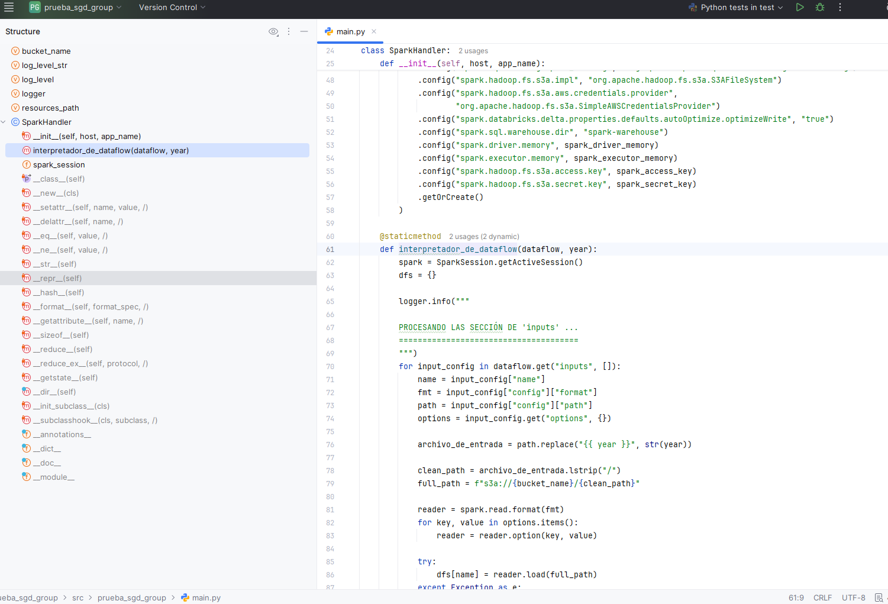

* A continuación ejecuta las transformaciones indicadas en el dataflow:

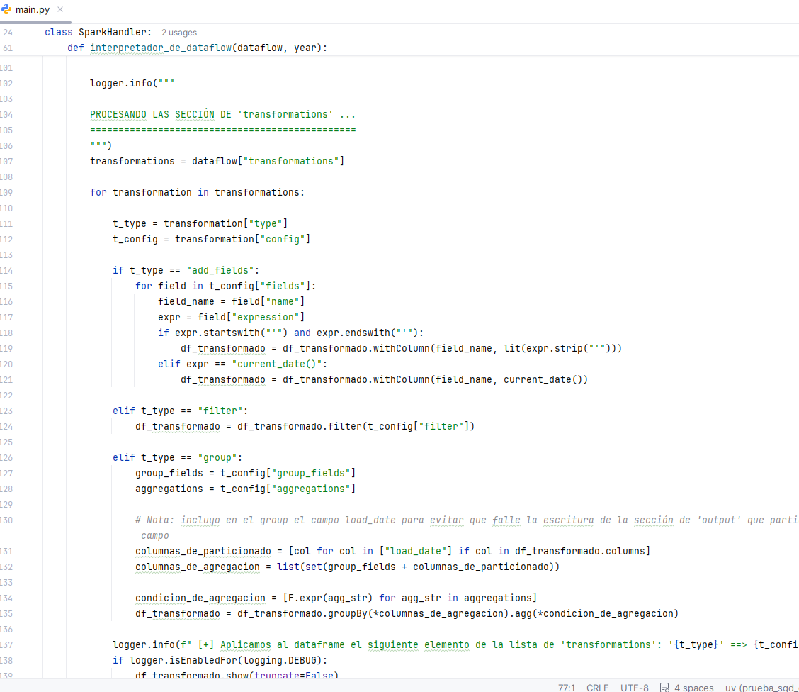

* Escribe los resultados en los destinos especificados:

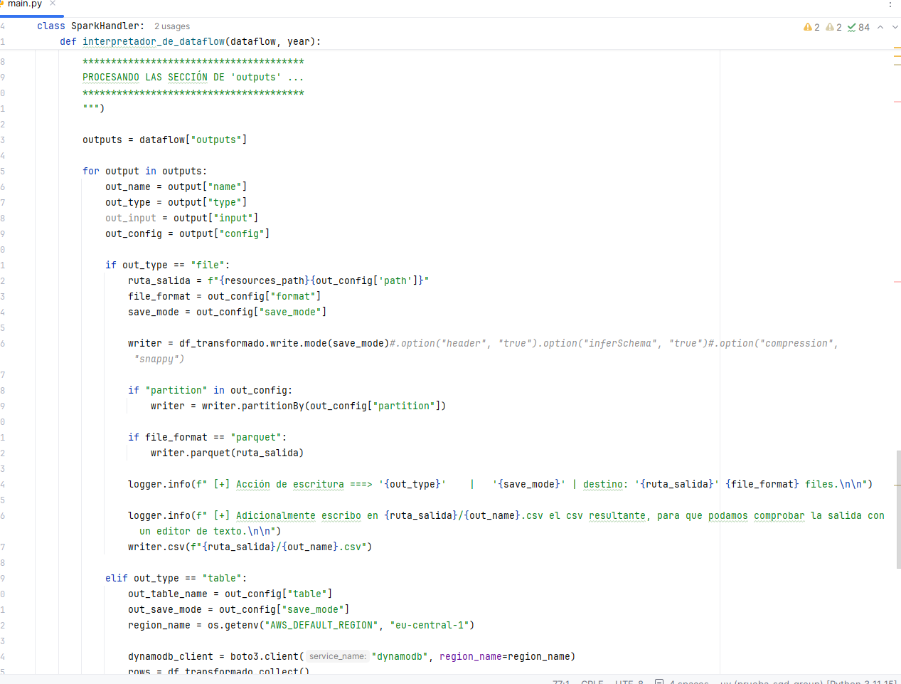


## Descripción de las pruebas de la funcionalidad desarrollada

La infraestructura de test está contenida en el archivo test_main.py:

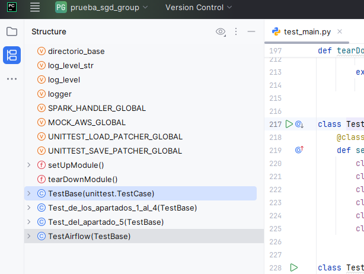

Los componentes principales de este archivo son:

* La función setUpModule() - Mockea los servicios de AWS y el cluster local de Spark

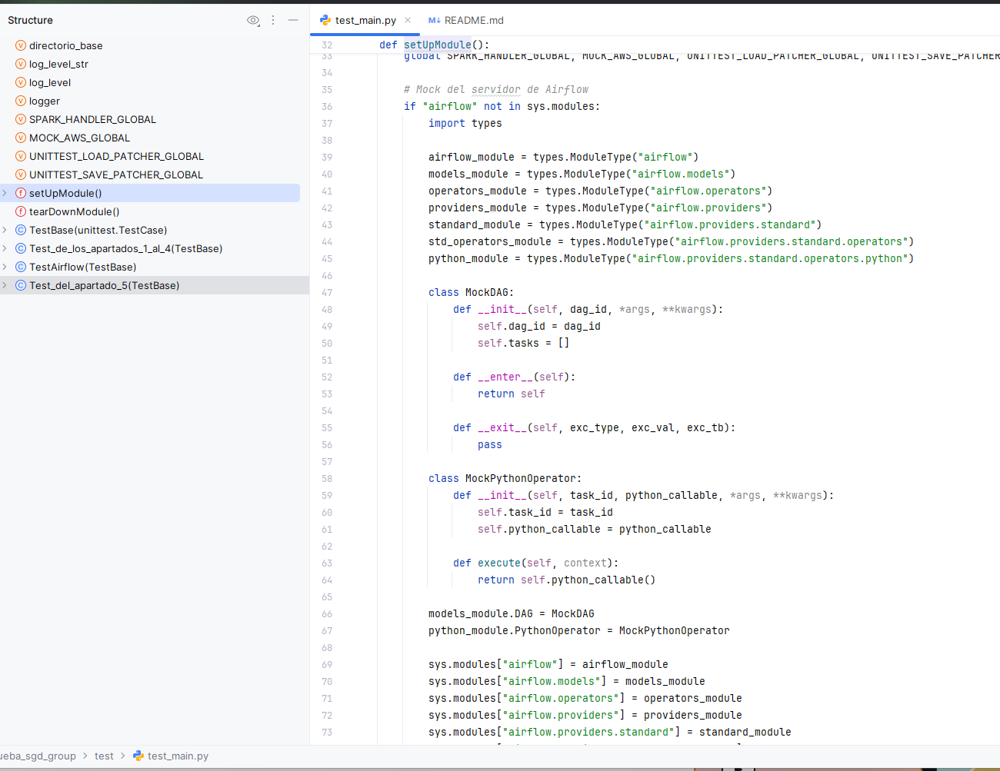

* La función tearDownModule() - Elimina la infraestructura mockeada.

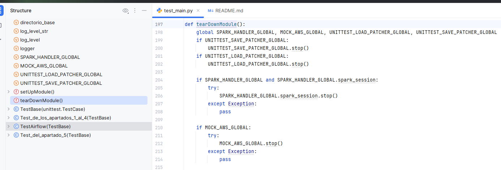

* La clase TestBase - Inicializa los clientes que acceden a los componentes AWS y al cluster local de Spark y Hadoop:

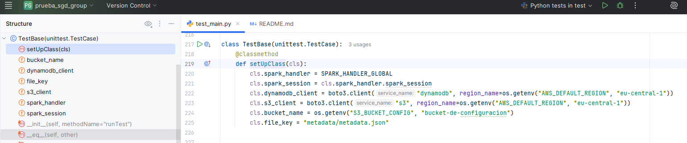

* La clase Test_de_los_apartados_1_al_4(TestBase) - Ejecuta y valida el método `interpretador_de_dataflow(dataflow, year)` con todos los
  los dataflows contenidos en el archivo `metadata.json` para todos los csv de entrada:

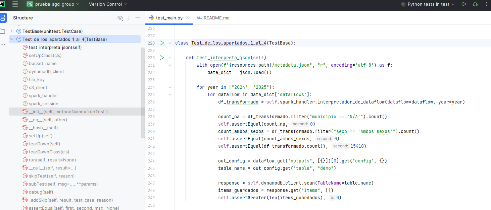

* La clase TestAirflow(TestBase) - Planifica en el servidor mockeado de Airflow una tarea recurrente que ejecuta cada
  cinco minutos el método `interpretador_de_dataflow(dataflow, year)`  

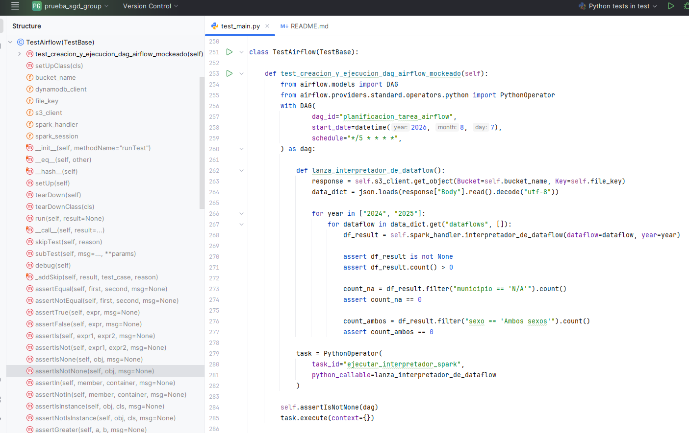

* La clase Test_apartado_5(TestBase) - Valida los datos de entrada de manera acorde a los requisitos expuestos en el enunciado:

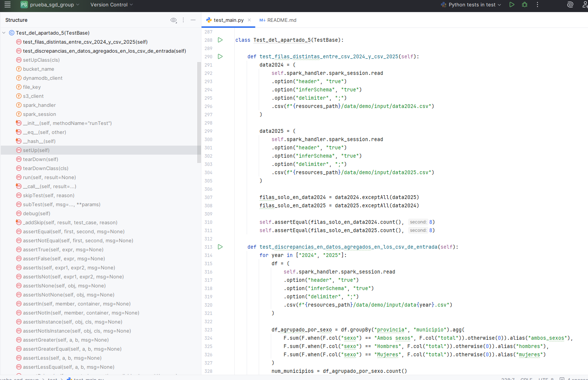


## Ejecución de las pruebas de la funcionalidad desarrollada

Evita que PyTest oculte la salida estándar poniendo este parámetro: 

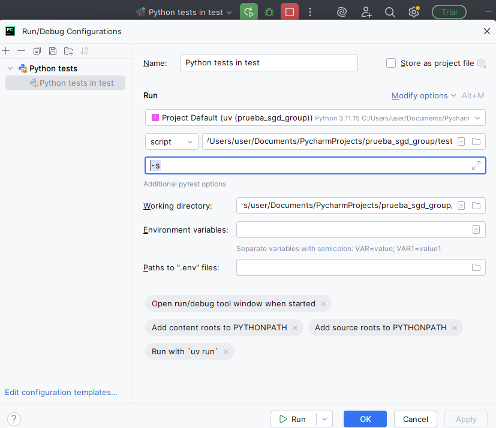

Y lanza los tests:

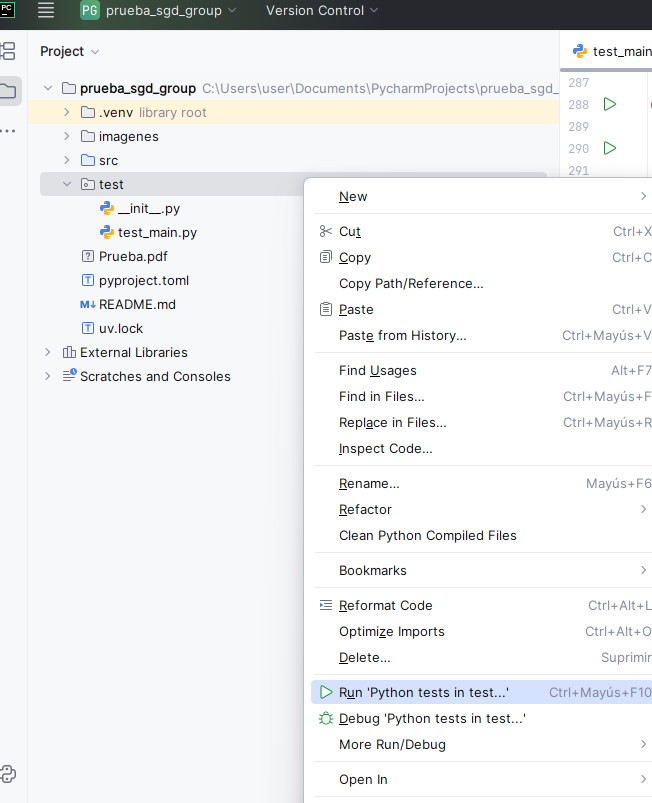

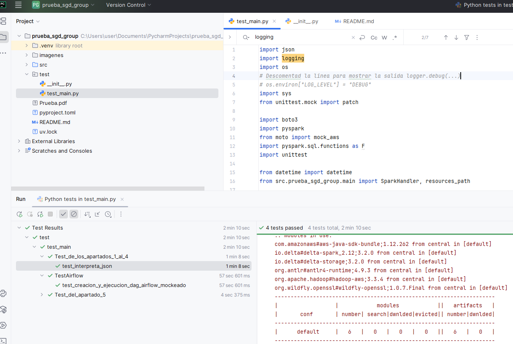

## Diferencias entre el comportamiento entre los almacenamientos overwrite, append y merge

Para ilustrar mejor este comportamiento, adicionalmente al test genérico he preparado un par de tests con una fracción de los
datos entrada csv que vemos a continuación.

### test_informe_overwrite_append_merge_CSV_1_registro

Más que un registro debería de llamarse algo como lo más simple posible; uso sólo una provincia y una línea por sexo, incluída la agregación.

Estos son los datos de entrada:

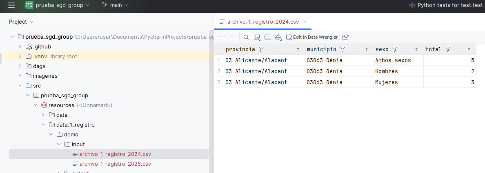

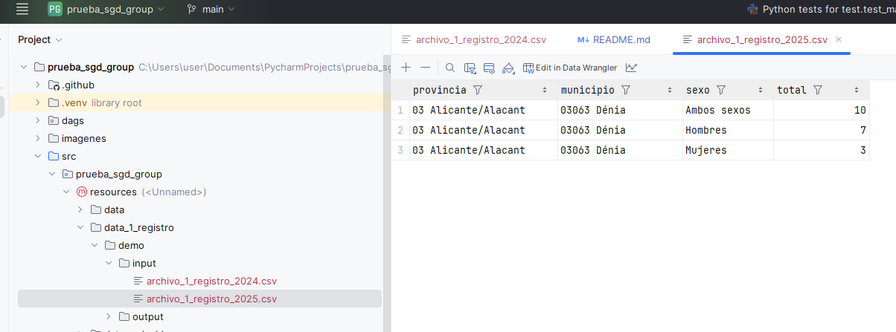

Este es el test en cuestión:

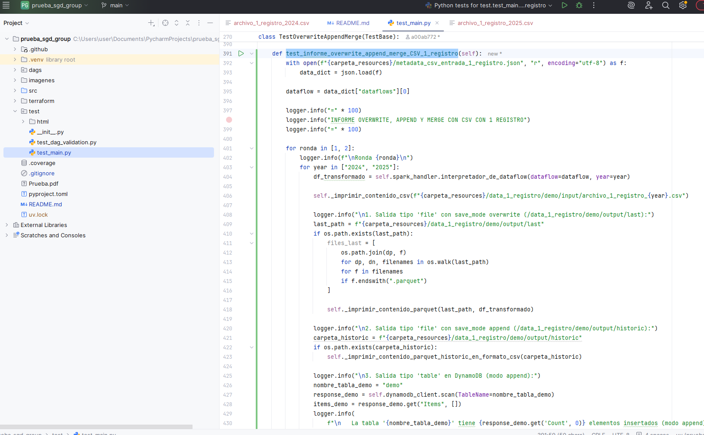

### test_informe_overwrite_append_merge_CSV_REDUCIDOS

Los datos de entrada son estos:

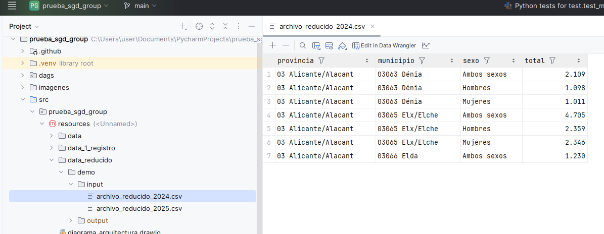

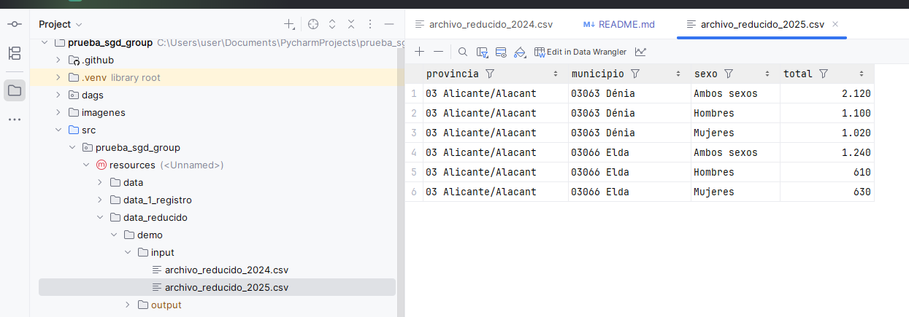

Este es el test en cuestión:

**Resultado de la ejecución**

```shell
====================================================================================================
INFORME OVERWRITE, APPEND Y MERGE CON CSV CON 1 REGISTRO
====================================================================================================

        
        A continuación vamos a leer los archivos csv de entrada de 2024 y 2025 en dos rondas, mostrando en cada una de ellas las
        salidas overwrite, append y merge que hemos obtenido.
        
        

Ronda 1

----------------------------------------------------------------------------------------------------

[+] Leyendo archivo de entrada C:\Users\user\Documents\PycharmProjects\prueba_sgd_group\src\prueba_sgd_group/resources/data_1_registro/demo/input/archivo_1_registro_2024.csv

    Contenido del archivo C:\Users\user\Documents\PycharmProjects\prueba_sgd_group\src\prueba_sgd_group/resources/data_1_registro/demo/input/archivo_1_registro_2024.csv (3 registros):

    provincia          | municipio   | sexo        | total
    --------------------+-------------+-------------+------
    03 Alicante/Alacant | 03063 Dénia | Ambos sexos | 5    
    03 Alicante/Alacant | 03063 Dénia | Hombres     | 2    
    03 Alicante/Alacant | 03063 Dénia | Mujeres     | 3    
----------------------------------------------------------------------------------------------------
                                                                                
1. Salida tipo 'file' con save_mode overwrite (/data_1_registro/demo/output/last):

   Contenido actual de las filas en el Parquet (2 registros):
    provincia           | municipio   | sexo    | total_ambos_sexos | load_date 
    --------------------+-------------+---------+-------------------+-----------
    03 Alicante/Alacant | 03063 Dénia | Mujeres | 3.0               | 2026-08-24
    03 Alicante/Alacant | 03063 Dénia | Hombres | 2.0               | 2026-08-24

2. Salida tipo 'file' con save_mode append (/data_1_registro/demo/output/historic):

    Contenido unificado de todos los CSVs almacenados en la carpeta parquet 'historic' (2 registros):

    provincia           | municipio   | sexo    | total_ambos_sexos
    --------------------+-------------+---------+------------------
    03 Alicante/Alacant | 03063 Dénia | Mujeres | 3.0              
    03 Alicante/Alacant | 03063 Dénia | Hombres | 2.0              
----------------------------------------------------------------------------------------------------

3. Salida tipo 'table' en DynamoDB (modo append):

   La tabla 'demo' tiene 1 elementos insertados (modo append):
     - {'provincia': {'S': '03 Alicante/Alacant'}, 'municipio': {'S': '03063 Dénia'}, 'sexo': {'S': 'Hombres'}, 'total_ambos_sexos': {'N': '2.0'}, 'load_date': {'S': '2026-08-24'}}

4. Salida tipo 'table' en DynamoDB (modo merge):

   La tabla 'raw_demo' tiene 1 elementos insertados (modo merge):
     - {'provincia': {'S': '03 Alicante/Alacant'}, 'municipio': {'S': '03063 Dénia'}, 'sexo': {'S': 'Hombres'}, 'total_ambos_sexos': {'N': '2.0'}, 'load_date': {'S': '2026-08-24'}}

====================================================================================================
----------------------------------------------------------------------------------------------------

[+] Leyendo archivo de entrada C:\Users\user\Documents\PycharmProjects\prueba_sgd_group\src\prueba_sgd_group/resources/data_1_registro/demo/input/archivo_1_registro_2025.csv

    Contenido del archivo C:\Users\user\Documents\PycharmProjects\prueba_sgd_group\src\prueba_sgd_group/resources/data_1_registro/demo/input/archivo_1_registro_2025.csv (3 registros):

    provincia          | municipio   | sexo        | total
    --------------------+-------------+-------------+------
    03 Alicante/Alacant | 03063 Dénia | Ambos sexos | 10   
    03 Alicante/Alacant | 03063 Dénia | Hombres     | 7    
    03 Alicante/Alacant | 03063 Dénia | Mujeres     | 3    
----------------------------------------------------------------------------------------------------

1. Salida tipo 'file' con save_mode overwrite (/data_1_registro/demo/output/last):

   Contenido actual de las filas en el Parquet (2 registros):
    provincia           | municipio   | sexo    | total_ambos_sexos | load_date 
    --------------------+-------------+---------+-------------------+-----------
    03 Alicante/Alacant | 03063 Dénia | Mujeres | 3.0               | 2026-08-24
    03 Alicante/Alacant | 03063 Dénia | Hombres | 7.0               | 2026-08-24

2. Salida tipo 'file' con save_mode append (/data_1_registro/demo/output/historic):

    Contenido unificado de todos los CSVs almacenados en la carpeta parquet 'historic' (4 registros):

    provincia           | municipio   | sexo    | total_ambos_sexos
    --------------------+-------------+---------+------------------
    03 Alicante/Alacant | 03063 Dénia | Mujeres | 3.0              
    03 Alicante/Alacant | 03063 Dénia | Hombres | 7.0              
    03 Alicante/Alacant | 03063 Dénia | Mujeres | 3.0              
    03 Alicante/Alacant | 03063 Dénia | Hombres | 2.0              
----------------------------------------------------------------------------------------------------

3. Salida tipo 'table' en DynamoDB (modo append):

   La tabla 'demo' tiene 1 elementos insertados (modo append):
     - {'provincia': {'S': '03 Alicante/Alacant'}, 'municipio': {'S': '03063 Dénia'}, 'sexo': {'S': 'Hombres'}, 'total_ambos_sexos': {'N': '7.0'}, 'load_date': {'S': '2026-08-24'}}

4. Salida tipo 'table' en DynamoDB (modo merge):

   La tabla 'raw_demo' tiene 1 elementos insertados (modo merge):
     - {'provincia': {'S': '03 Alicante/Alacant'}, 'municipio': {'S': '03063 Dénia'}, 'sexo': {'S': 'Hombres'}, 'total_ambos_sexos': {'N': '7.0'}, 'load_date': {'S': '2026-08-24'}}

====================================================================================================

Ronda 2

----------------------------------------------------------------------------------------------------

[+] Leyendo archivo de entrada C:\Users\user\Documents\PycharmProjects\prueba_sgd_group\src\prueba_sgd_group/resources/data_1_registro/demo/input/archivo_1_registro_2024.csv

    Contenido del archivo C:\Users\user\Documents\PycharmProjects\prueba_sgd_group\src\prueba_sgd_group/resources/data_1_registro/demo/input/archivo_1_registro_2024.csv (3 registros):

    provincia          | municipio   | sexo        | total
    --------------------+-------------+-------------+------
    03 Alicante/Alacant | 03063 Dénia | Ambos sexos | 5    
    03 Alicante/Alacant | 03063 Dénia | Hombres     | 2    
    03 Alicante/Alacant | 03063 Dénia | Mujeres     | 3    
----------------------------------------------------------------------------------------------------

1. Salida tipo 'file' con save_mode overwrite (/data_1_registro/demo/output/last):

   Contenido actual de las filas en el Parquet (2 registros):
    provincia           | municipio   | sexo    | total_ambos_sexos | load_date 
    --------------------+-------------+---------+-------------------+-----------
    03 Alicante/Alacant | 03063 Dénia | Mujeres | 3.0               | 2026-08-24
    03 Alicante/Alacant | 03063 Dénia | Hombres | 2.0               | 2026-08-24

2. Salida tipo 'file' con save_mode append (/data_1_registro/demo/output/historic):

    Contenido unificado de todos los CSVs almacenados en la carpeta parquet 'historic' (6 registros):

    provincia           | municipio   | sexo    | total_ambos_sexos
    --------------------+-------------+---------+------------------
    03 Alicante/Alacant | 03063 Dénia | Mujeres | 3.0              
    03 Alicante/Alacant | 03063 Dénia | Hombres | 7.0              
    03 Alicante/Alacant | 03063 Dénia | Mujeres | 3.0              
    03 Alicante/Alacant | 03063 Dénia | Hombres | 2.0              
    03 Alicante/Alacant | 03063 Dénia | Mujeres | 3.0              
    03 Alicante/Alacant | 03063 Dénia | Hombres | 2.0              
----------------------------------------------------------------------------------------------------

3. Salida tipo 'table' en DynamoDB (modo append):

   La tabla 'demo' tiene 1 elementos insertados (modo append):
     - {'provincia': {'S': '03 Alicante/Alacant'}, 'municipio': {'S': '03063 Dénia'}, 'sexo': {'S': 'Hombres'}, 'total_ambos_sexos': {'N': '2.0'}, 'load_date': {'S': '2026-08-24'}}

4. Salida tipo 'table' en DynamoDB (modo merge):

   La tabla 'raw_demo' tiene 1 elementos insertados (modo merge):
     - {'provincia': {'S': '03 Alicante/Alacant'}, 'municipio': {'S': '03063 Dénia'}, 'sexo': {'S': 'Hombres'}, 'total_ambos_sexos': {'N': '2.0'}, 'load_date': {'S': '2026-08-24'}}

====================================================================================================
----------------------------------------------------------------------------------------------------

[+] Leyendo archivo de entrada C:\Users\user\Documents\PycharmProjects\prueba_sgd_group\src\prueba_sgd_group/resources/data_1_registro/demo/input/archivo_1_registro_2025.csv

    Contenido del archivo C:\Users\user\Documents\PycharmProjects\prueba_sgd_group\src\prueba_sgd_group/resources/data_1_registro/demo/input/archivo_1_registro_2025.csv (3 registros):

    provincia          | municipio   | sexo        | total
    --------------------+-------------+-------------+------
    03 Alicante/Alacant | 03063 Dénia | Ambos sexos | 10   
    03 Alicante/Alacant | 03063 Dénia | Hombres     | 7    
    03 Alicante/Alacant | 03063 Dénia | Mujeres     | 3    
----------------------------------------------------------------------------------------------------

1. Salida tipo 'file' con save_mode overwrite (/data_1_registro/demo/output/last):

   Contenido actual de las filas en el Parquet (2 registros):
    provincia           | municipio   | sexo    | total_ambos_sexos | load_date 
    --------------------+-------------+---------+-------------------+-----------
    03 Alicante/Alacant | 03063 Dénia | Mujeres | 3.0               | 2026-08-24
    03 Alicante/Alacant | 03063 Dénia | Hombres | 7.0               | 2026-08-24

2. Salida tipo 'file' con save_mode append (/data_1_registro/demo/output/historic):

    Contenido unificado de todos los CSVs almacenados en la carpeta parquet 'historic' (8 registros):

    provincia           | municipio   | sexo    | total_ambos_sexos
    --------------------+-------------+---------+------------------
    03 Alicante/Alacant | 03063 Dénia | Mujeres | 3.0              
    03 Alicante/Alacant | 03063 Dénia | Hombres | 7.0              
    03 Alicante/Alacant | 03063 Dénia | Mujeres | 3.0              
    03 Alicante/Alacant | 03063 Dénia | Hombres | 7.0              
    03 Alicante/Alacant | 03063 Dénia | Mujeres | 3.0              
    03 Alicante/Alacant | 03063 Dénia | Hombres | 2.0              
    03 Alicante/Alacant | 03063 Dénia | Mujeres | 3.0              
    03 Alicante/Alacant | 03063 Dénia | Hombres | 2.0              
----------------------------------------------------------------------------------------------------

3. Salida tipo 'table' en DynamoDB (modo append):

   La tabla 'demo' tiene 1 elementos insertados (modo append):
     - {'provincia': {'S': '03 Alicante/Alacant'}, 'municipio': {'S': '03063 Dénia'}, 'sexo': {'S': 'Hombres'}, 'total_ambos_sexos': {'N': '7.0'}, 'load_date': {'S': '2026-08-24'}}

4. Salida tipo 'table' en DynamoDB (modo merge):

   La tabla 'raw_demo' tiene 1 elementos insertados (modo merge):
     - {'provincia': {'S': '03 Alicante/Alacant'}, 'municipio': {'S': '03063 Dénia'}, 'sexo': {'S': 'Hombres'}, 'total_ambos_sexos': {'N': '7.0'}, 'load_date': {'S': '2026-08-24'}}

====================================================================================================
```

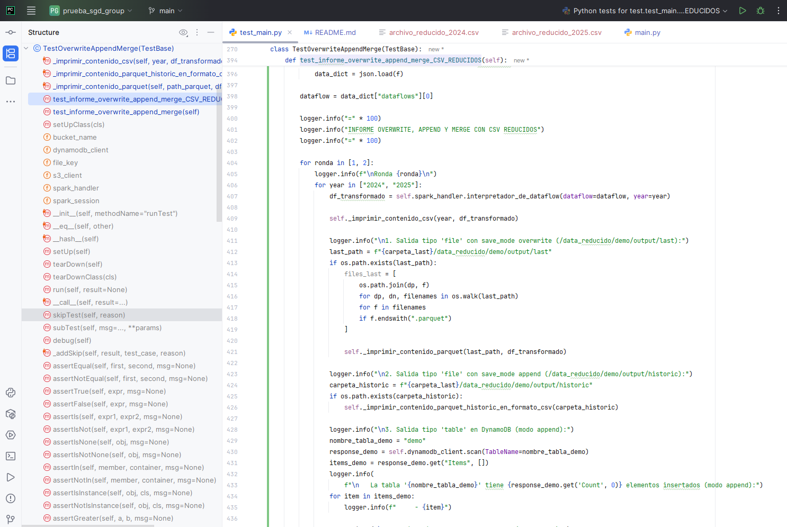

**Resultado de la ejecución**

```shell
====================================================================================================
INFORME OVERWRITE, APPEND Y MERGE CON CSV REDUCIDOS
====================================================================================================


        A continuación vamos a leer los archivos csv de entrada de 2024 y 2025 en dos rondas, mostrando en cada una de ellas las
        salidas overwrite, append y merge que hemos obtenido.
        

Ronda 1

----------------------------------------------------------------------------------------------------

[+] Leyendo archivo de entrada C:\Users\user\Documents\PycharmProjects\prueba_sgd_group\src\prueba_sgd_group/resources/data_reducido/demo/input/archivo_reducido_2024.csv

    Contenido del archivo C:\Users\user\Documents\PycharmProjects\prueba_sgd_group\src\prueba_sgd_group/resources/data_reducido/demo/input/archivo_reducido_2024.csv (7 registros):

    provincia          | municipio       | sexo        | total
    --------------------+-----------------+-------------+------
    03 Alicante/Alacant | 03063 Dénia     | Ambos sexos | 2.109
    03 Alicante/Alacant | 03063 Dénia     | Hombres     | 1.098
    03 Alicante/Alacant | 03063 Dénia     | Mujeres     | 1.011
    03 Alicante/Alacant | 03065 Elx/Elche | Ambos sexos | 4.705
    03 Alicante/Alacant | 03065 Elx/Elche | Hombres     | 2.359
    03 Alicante/Alacant | 03065 Elx/Elche | Mujeres     | 2.346
    03 Alicante/Alacant | 03066 Elda      | Ambos sexos | 1.230
----------------------------------------------------------------------------------------------------

1. Salida tipo 'file' con save_mode overwrite (/data_reducido/demo/output/last):

   Contenido actual de las filas en el Parquet (4 registros):
    provincia           | municipio       | sexo    | total_ambos_sexos | load_date 
    --------------------+-----------------+---------+-------------------+-----------
    03 Alicante/Alacant | 03063 Dénia     | Mujeres | 1011              | 2026-08-24
    03 Alicante/Alacant | 03065 Elx/Elche | Hombres | 2359              | 2026-08-24
    03 Alicante/Alacant | 03063 Dénia     | Hombres | 1098              | 2026-08-24
    03 Alicante/Alacant | 03065 Elx/Elche | Mujeres | 2346              | 2026-08-24

2. Salida tipo 'file' con save_mode append (/data_reducido/demo/output/historic):

    Contenido unificado de todos los CSVs almacenados en la carpeta parquet 'historic' (4 registros):

    provincia           | municipio       | sexo    | total_ambos_sexos
    --------------------+-----------------+---------+------------------
    03 Alicante/Alacant | 03063 Dénia     | Mujeres | 1011             
    03 Alicante/Alacant | 03065 Elx/Elche | Hombres | 2359             
    03 Alicante/Alacant | 03063 Dénia     | Hombres | 1098             
    03 Alicante/Alacant | 03065 Elx/Elche | Mujeres | 2346             
----------------------------------------------------------------------------------------------------

3. Salida tipo 'table' en DynamoDB (modo append):

   La tabla 'demo' tiene 4 elementos insertados (modo append):
     - {'provincia': {'S': '03 Alicante/Alacant'}, 'municipio': {'S': '03063 Dénia'}, 'sexo': {'S': 'Hombres'}, 'total_ambos_sexos': {'N': '1098'}, 'load_date': {'S': '2026-08-24'}, 'municipio_sexo_date': {'S': '03063 Dénia#Hombres#2026-08-24'}}
     - {'provincia': {'S': '03 Alicante/Alacant'}, 'municipio': {'S': '03063 Dénia'}, 'sexo': {'S': 'Mujeres'}, 'total_ambos_sexos': {'N': '1011'}, 'load_date': {'S': '2026-08-24'}, 'municipio_sexo_date': {'S': '03063 Dénia#Mujeres#2026-08-24'}}
     - {'provincia': {'S': '03 Alicante/Alacant'}, 'municipio': {'S': '03065 Elx/Elche'}, 'sexo': {'S': 'Hombres'}, 'total_ambos_sexos': {'N': '2359'}, 'load_date': {'S': '2026-08-24'}, 'municipio_sexo_date': {'S': '03065 Elx/Elche#Hombres#2026-08-24'}}
     - {'provincia': {'S': '03 Alicante/Alacant'}, 'municipio': {'S': '03065 Elx/Elche'}, 'sexo': {'S': 'Mujeres'}, 'total_ambos_sexos': {'N': '2346'}, 'load_date': {'S': '2026-08-24'}, 'municipio_sexo_date': {'S': '03065 Elx/Elche#Mujeres#2026-08-24'}}

4. Salida tipo 'table' en DynamoDB (modo merge):

   La tabla 'raw_demo' tiene 4 elementos insertados (modo merge):
     - {'provincia': {'S': '03 Alicante/Alacant'}, 'municipio': {'S': '03063 Dénia'}, 'sexo': {'S': 'Hombres'}, 'total_ambos_sexos': {'N': '1098'}, 'load_date': {'S': '2026-08-24'}, 'municipio_sexo': {'S': '03063 Dénia#Hombres'}}
     - {'provincia': {'S': '03 Alicante/Alacant'}, 'municipio': {'S': '03063 Dénia'}, 'sexo': {'S': 'Mujeres'}, 'total_ambos_sexos': {'N': '1011'}, 'load_date': {'S': '2026-08-24'}, 'municipio_sexo': {'S': '03063 Dénia#Mujeres'}}
     - {'provincia': {'S': '03 Alicante/Alacant'}, 'municipio': {'S': '03065 Elx/Elche'}, 'sexo': {'S': 'Hombres'}, 'total_ambos_sexos': {'N': '2359'}, 'load_date': {'S': '2026-08-24'}, 'municipio_sexo': {'S': '03065 Elx/Elche#Hombres'}}
     - {'provincia': {'S': '03 Alicante/Alacant'}, 'municipio': {'S': '03065 Elx/Elche'}, 'sexo': {'S': 'Mujeres'}, 'total_ambos_sexos': {'N': '2346'}, 'load_date': {'S': '2026-08-24'}, 'municipio_sexo': {'S': '03065 Elx/Elche#Mujeres'}}

====================================================================================================
----------------------------------------------------------------------------------------------------

[+] Leyendo archivo de entrada C:\Users\user\Documents\PycharmProjects\prueba_sgd_group\src\prueba_sgd_group/resources/data_reducido/demo/input/archivo_reducido_2025.csv

    Contenido del archivo C:\Users\user\Documents\PycharmProjects\prueba_sgd_group\src\prueba_sgd_group/resources/data_reducido/demo/input/archivo_reducido_2025.csv (6 registros):

    provincia          | municipio   | sexo        | total
    --------------------+-------------+-------------+------
    03 Alicante/Alacant | 03063 Dénia | Ambos sexos | 2.120
    03 Alicante/Alacant | 03063 Dénia | Hombres     | 1.100
    03 Alicante/Alacant | 03063 Dénia | Mujeres     | 1.020
    03 Alicante/Alacant | 03066 Elda  | Ambos sexos | 1.240
    03 Alicante/Alacant | 03066 Elda  | Hombres     | 610  
    03 Alicante/Alacant | 03066 Elda  | Mujeres     | 630  
----------------------------------------------------------------------------------------------------

1. Salida tipo 'file' con save_mode overwrite (/data_reducido/demo/output/last):

   Contenido actual de las filas en el Parquet (4 registros):
    provincia           | municipio   | sexo    | total_ambos_sexos | load_date 
    --------------------+-------------+---------+-------------------+-----------
    03 Alicante/Alacant | 03066 Elda  | Mujeres | 630               | 2026-08-24
    03 Alicante/Alacant | 03063 Dénia | Mujeres | 1020              | 2026-08-24
    03 Alicante/Alacant | 03066 Elda  | Hombres | 610               | 2026-08-24
    03 Alicante/Alacant | 03063 Dénia | Hombres | 1100              | 2026-08-24

2. Salida tipo 'file' con save_mode append (/data_reducido/demo/output/historic):

    Contenido unificado de todos los CSVs almacenados en la carpeta parquet 'historic' (8 registros):

    provincia           | municipio       | sexo    | total_ambos_sexos
    --------------------+-----------------+---------+------------------
    03 Alicante/Alacant | 03066 Elda      | Mujeres | 630              
    03 Alicante/Alacant | 03063 Dénia     | Mujeres | 1020             
    03 Alicante/Alacant | 03066 Elda      | Hombres | 610              
    03 Alicante/Alacant | 03063 Dénia     | Hombres | 1100             
    03 Alicante/Alacant | 03063 Dénia     | Mujeres | 1011             
    03 Alicante/Alacant | 03065 Elx/Elche | Hombres | 2359             
    03 Alicante/Alacant | 03063 Dénia     | Hombres | 1098             
    03 Alicante/Alacant | 03065 Elx/Elche | Mujeres | 2346             
----------------------------------------------------------------------------------------------------

3. Salida tipo 'table' en DynamoDB (modo append):

   La tabla 'demo' tiene 6 elementos insertados (modo append):
     - {'provincia': {'S': '03 Alicante/Alacant'}, 'municipio': {'S': '03063 Dénia'}, 'sexo': {'S': 'Hombres'}, 'total_ambos_sexos': {'N': '1100'}, 'load_date': {'S': '2026-08-24'}, 'municipio_sexo_date': {'S': '03063 Dénia#Hombres#2026-08-24'}}
     - {'provincia': {'S': '03 Alicante/Alacant'}, 'municipio': {'S': '03063 Dénia'}, 'sexo': {'S': 'Mujeres'}, 'total_ambos_sexos': {'N': '1020'}, 'load_date': {'S': '2026-08-24'}, 'municipio_sexo_date': {'S': '03063 Dénia#Mujeres#2026-08-24'}}
     - {'provincia': {'S': '03 Alicante/Alacant'}, 'municipio': {'S': '03065 Elx/Elche'}, 'sexo': {'S': 'Hombres'}, 'total_ambos_sexos': {'N': '2359'}, 'load_date': {'S': '2026-08-24'}, 'municipio_sexo_date': {'S': '03065 Elx/Elche#Hombres#2026-08-24'}}
     - {'provincia': {'S': '03 Alicante/Alacant'}, 'municipio': {'S': '03065 Elx/Elche'}, 'sexo': {'S': 'Mujeres'}, 'total_ambos_sexos': {'N': '2346'}, 'load_date': {'S': '2026-08-24'}, 'municipio_sexo_date': {'S': '03065 Elx/Elche#Mujeres#2026-08-24'}}
     - {'provincia': {'S': '03 Alicante/Alacant'}, 'municipio': {'S': '03066 Elda'}, 'sexo': {'S': 'Hombres'}, 'total_ambos_sexos': {'N': '610'}, 'load_date': {'S': '2026-08-24'}, 'municipio_sexo_date': {'S': '03066 Elda#Hombres#2026-08-24'}}
     - {'provincia': {'S': '03 Alicante/Alacant'}, 'municipio': {'S': '03066 Elda'}, 'sexo': {'S': 'Mujeres'}, 'total_ambos_sexos': {'N': '630'}, 'load_date': {'S': '2026-08-24'}, 'municipio_sexo_date': {'S': '03066 Elda#Mujeres#2026-08-24'}}

4. Salida tipo 'table' en DynamoDB (modo merge):

   La tabla 'raw_demo' tiene 6 elementos insertados (modo merge):
     - {'provincia': {'S': '03 Alicante/Alacant'}, 'municipio': {'S': '03063 Dénia'}, 'sexo': {'S': 'Hombres'}, 'total_ambos_sexos': {'N': '1100'}, 'load_date': {'S': '2026-08-24'}, 'municipio_sexo': {'S': '03063 Dénia#Hombres'}}
     - {'provincia': {'S': '03 Alicante/Alacant'}, 'municipio': {'S': '03063 Dénia'}, 'sexo': {'S': 'Mujeres'}, 'total_ambos_sexos': {'N': '1020'}, 'load_date': {'S': '2026-08-24'}, 'municipio_sexo': {'S': '03063 Dénia#Mujeres'}}
     - {'provincia': {'S': '03 Alicante/Alacant'}, 'municipio': {'S': '03065 Elx/Elche'}, 'sexo': {'S': 'Hombres'}, 'total_ambos_sexos': {'N': '2359'}, 'load_date': {'S': '2026-08-24'}, 'municipio_sexo': {'S': '03065 Elx/Elche#Hombres'}}
     - {'provincia': {'S': '03 Alicante/Alacant'}, 'municipio': {'S': '03065 Elx/Elche'}, 'sexo': {'S': 'Mujeres'}, 'total_ambos_sexos': {'N': '2346'}, 'load_date': {'S': '2026-08-24'}, 'municipio_sexo': {'S': '03065 Elx/Elche#Mujeres'}}
     - {'provincia': {'S': '03 Alicante/Alacant'}, 'municipio': {'S': '03066 Elda'}, 'sexo': {'S': 'Hombres'}, 'total_ambos_sexos': {'N': '610'}, 'load_date': {'S': '2026-08-24'}, 'municipio_sexo': {'S': '03066 Elda#Hombres'}}
     - {'provincia': {'S': '03 Alicante/Alacant'}, 'municipio': {'S': '03066 Elda'}, 'sexo': {'S': 'Mujeres'}, 'total_ambos_sexos': {'N': '630'}, 'load_date': {'S': '2026-08-24'}, 'municipio_sexo': {'S': '03066 Elda#Mujeres'}}

====================================================================================================

Ronda 2

----------------------------------------------------------------------------------------------------

[+] Leyendo archivo de entrada C:\Users\user\Documents\PycharmProjects\prueba_sgd_group\src\prueba_sgd_group/resources/data_reducido/demo/input/archivo_reducido_2024.csv

    Contenido del archivo C:\Users\user\Documents\PycharmProjects\prueba_sgd_group\src\prueba_sgd_group/resources/data_reducido/demo/input/archivo_reducido_2024.csv (7 registros):

    provincia          | municipio       | sexo        | total
    --------------------+-----------------+-------------+------
    03 Alicante/Alacant | 03063 Dénia     | Ambos sexos | 2.109
    03 Alicante/Alacant | 03063 Dénia     | Hombres     | 1.098
    03 Alicante/Alacant | 03063 Dénia     | Mujeres     | 1.011
    03 Alicante/Alacant | 03065 Elx/Elche | Ambos sexos | 4.705
    03 Alicante/Alacant | 03065 Elx/Elche | Hombres     | 2.359
    03 Alicante/Alacant | 03065 Elx/Elche | Mujeres     | 2.346
    03 Alicante/Alacant | 03066 Elda      | Ambos sexos | 1.230
----------------------------------------------------------------------------------------------------

1. Salida tipo 'file' con save_mode overwrite (/data_reducido/demo/output/last):

   Contenido actual de las filas en el Parquet (4 registros):
    provincia           | municipio       | sexo    | total_ambos_sexos | load_date 
    --------------------+-----------------+---------+-------------------+-----------
    03 Alicante/Alacant | 03063 Dénia     | Mujeres | 1011              | 2026-08-24
    03 Alicante/Alacant | 03065 Elx/Elche | Hombres | 2359              | 2026-08-24
    03 Alicante/Alacant | 03063 Dénia     | Hombres | 1098              | 2026-08-24
    03 Alicante/Alacant | 03065 Elx/Elche | Mujeres | 2346              | 2026-08-24

2. Salida tipo 'file' con save_mode append (/data_reducido/demo/output/historic):

    Contenido unificado de todos los CSVs almacenados en la carpeta parquet 'historic' (12 registros):

    provincia           | municipio       | sexo    | total_ambos_sexos
    --------------------+-----------------+---------+------------------
    03 Alicante/Alacant | 03066 Elda      | Mujeres | 630              
    03 Alicante/Alacant | 03063 Dénia     | Mujeres | 1020             
    03 Alicante/Alacant | 03066 Elda      | Hombres | 610              
    03 Alicante/Alacant | 03063 Dénia     | Hombres | 1100             
    03 Alicante/Alacant | 03063 Dénia     | Mujeres | 1011             
    03 Alicante/Alacant | 03065 Elx/Elche | Hombres | 2359             
    03 Alicante/Alacant | 03063 Dénia     | Hombres | 1098             
    03 Alicante/Alacant | 03065 Elx/Elche | Mujeres | 2346             
    03 Alicante/Alacant | 03063 Dénia     | Mujeres | 1011             
    03 Alicante/Alacant | 03065 Elx/Elche | Hombres | 2359             
    03 Alicante/Alacant | 03063 Dénia     | Hombres | 1098             
    03 Alicante/Alacant | 03065 Elx/Elche | Mujeres | 2346             
----------------------------------------------------------------------------------------------------

3. Salida tipo 'table' en DynamoDB (modo append):

   La tabla 'demo' tiene 6 elementos insertados (modo append):
     - {'provincia': {'S': '03 Alicante/Alacant'}, 'municipio': {'S': '03063 Dénia'}, 'sexo': {'S': 'Hombres'}, 'total_ambos_sexos': {'N': '1098'}, 'load_date': {'S': '2026-08-24'}, 'municipio_sexo_date': {'S': '03063 Dénia#Hombres#2026-08-24'}}
     - {'provincia': {'S': '03 Alicante/Alacant'}, 'municipio': {'S': '03063 Dénia'}, 'sexo': {'S': 'Mujeres'}, 'total_ambos_sexos': {'N': '1011'}, 'load_date': {'S': '2026-08-24'}, 'municipio_sexo_date': {'S': '03063 Dénia#Mujeres#2026-08-24'}}
     - {'provincia': {'S': '03 Alicante/Alacant'}, 'municipio': {'S': '03065 Elx/Elche'}, 'sexo': {'S': 'Hombres'}, 'total_ambos_sexos': {'N': '2359'}, 'load_date': {'S': '2026-08-24'}, 'municipio_sexo_date': {'S': '03065 Elx/Elche#Hombres#2026-08-24'}}
     - {'provincia': {'S': '03 Alicante/Alacant'}, 'municipio': {'S': '03065 Elx/Elche'}, 'sexo': {'S': 'Mujeres'}, 'total_ambos_sexos': {'N': '2346'}, 'load_date': {'S': '2026-08-24'}, 'municipio_sexo_date': {'S': '03065 Elx/Elche#Mujeres#2026-08-24'}}
     - {'provincia': {'S': '03 Alicante/Alacant'}, 'municipio': {'S': '03066 Elda'}, 'sexo': {'S': 'Hombres'}, 'total_ambos_sexos': {'N': '610'}, 'load_date': {'S': '2026-08-24'}, 'municipio_sexo_date': {'S': '03066 Elda#Hombres#2026-08-24'}}
     - {'provincia': {'S': '03 Alicante/Alacant'}, 'municipio': {'S': '03066 Elda'}, 'sexo': {'S': 'Mujeres'}, 'total_ambos_sexos': {'N': '630'}, 'load_date': {'S': '2026-08-24'}, 'municipio_sexo_date': {'S': '03066 Elda#Mujeres#2026-08-24'}}

4. Salida tipo 'table' en DynamoDB (modo merge):

   La tabla 'raw_demo' tiene 6 elementos insertados (modo merge):
     - {'provincia': {'S': '03 Alicante/Alacant'}, 'municipio': {'S': '03063 Dénia'}, 'sexo': {'S': 'Hombres'}, 'total_ambos_sexos': {'N': '1098'}, 'load_date': {'S': '2026-08-24'}, 'municipio_sexo': {'S': '03063 Dénia#Hombres'}}
     - {'provincia': {'S': '03 Alicante/Alacant'}, 'municipio': {'S': '03063 Dénia'}, 'sexo': {'S': 'Mujeres'}, 'total_ambos_sexos': {'N': '1011'}, 'load_date': {'S': '2026-08-24'}, 'municipio_sexo': {'S': '03063 Dénia#Mujeres'}}
     - {'provincia': {'S': '03 Alicante/Alacant'}, 'municipio': {'S': '03065 Elx/Elche'}, 'sexo': {'S': 'Hombres'}, 'total_ambos_sexos': {'N': '2359'}, 'load_date': {'S': '2026-08-24'}, 'municipio_sexo': {'S': '03065 Elx/Elche#Hombres'}}
     - {'provincia': {'S': '03 Alicante/Alacant'}, 'municipio': {'S': '03065 Elx/Elche'}, 'sexo': {'S': 'Mujeres'}, 'total_ambos_sexos': {'N': '2346'}, 'load_date': {'S': '2026-08-24'}, 'municipio_sexo': {'S': '03065 Elx/Elche#Mujeres'}}
     - {'provincia': {'S': '03 Alicante/Alacant'}, 'municipio': {'S': '03066 Elda'}, 'sexo': {'S': 'Hombres'}, 'total_ambos_sexos': {'N': '610'}, 'load_date': {'S': '2026-08-24'}, 'municipio_sexo': {'S': '03066 Elda#Hombres'}}
     - {'provincia': {'S': '03 Alicante/Alacant'}, 'municipio': {'S': '03066 Elda'}, 'sexo': {'S': 'Mujeres'}, 'total_ambos_sexos': {'N': '630'}, 'load_date': {'S': '2026-08-24'}, 'municipio_sexo': {'S': '03066 Elda#Mujeres'}}

====================================================================================================
----------------------------------------------------------------------------------------------------

[+] Leyendo archivo de entrada C:\Users\user\Documents\PycharmProjects\prueba_sgd_group\src\prueba_sgd_group/resources/data_reducido/demo/input/archivo_reducido_2025.csv

    Contenido del archivo C:\Users\user\Documents\PycharmProjects\prueba_sgd_group\src\prueba_sgd_group/resources/data_reducido/demo/input/archivo_reducido_2025.csv (6 registros):

    provincia          | municipio   | sexo        | total
    --------------------+-------------+-------------+------
    03 Alicante/Alacant | 03063 Dénia | Ambos sexos | 2.120
    03 Alicante/Alacant | 03063 Dénia | Hombres     | 1.100
    03 Alicante/Alacant | 03063 Dénia | Mujeres     | 1.020
    03 Alicante/Alacant | 03066 Elda  | Ambos sexos | 1.240
    03 Alicante/Alacant | 03066 Elda  | Hombres     | 610  
    03 Alicante/Alacant | 03066 Elda  | Mujeres     | 630  
----------------------------------------------------------------------------------------------------

1. Salida tipo 'file' con save_mode overwrite (/data_reducido/demo/output/last):

   Contenido actual de las filas en el Parquet (4 registros):
    provincia           | municipio   | sexo    | total_ambos_sexos | load_date 
    --------------------+-------------+---------+-------------------+-----------
    03 Alicante/Alacant | 03066 Elda  | Mujeres | 630               | 2026-08-24
    03 Alicante/Alacant | 03063 Dénia | Mujeres | 1020              | 2026-08-24
    03 Alicante/Alacant | 03066 Elda  | Hombres | 610               | 2026-08-24
    03 Alicante/Alacant | 03063 Dénia | Hombres | 1100              | 2026-08-24

2. Salida tipo 'file' con save_mode append (/data_reducido/demo/output/historic):

    Contenido unificado de todos los CSVs almacenados en la carpeta parquet 'historic' (16 registros):

    provincia           | municipio       | sexo    | total_ambos_sexos
    --------------------+-----------------+---------+------------------
    03 Alicante/Alacant | 03066 Elda      | Mujeres | 630              
    03 Alicante/Alacant | 03063 Dénia     | Mujeres | 1020             
    03 Alicante/Alacant | 03066 Elda      | Hombres | 610              
    03 Alicante/Alacant | 03063 Dénia     | Hombres | 1100             
    03 Alicante/Alacant | 03066 Elda      | Mujeres | 630              
    03 Alicante/Alacant | 03063 Dénia     | Mujeres | 1020             
    03 Alicante/Alacant | 03066 Elda      | Hombres | 610              
    03 Alicante/Alacant | 03063 Dénia     | Hombres | 1100             
    03 Alicante/Alacant | 03063 Dénia     | Mujeres | 1011             
    03 Alicante/Alacant | 03065 Elx/Elche | Hombres | 2359             
    03 Alicante/Alacant | 03063 Dénia     | Hombres | 1098             
    03 Alicante/Alacant | 03065 Elx/Elche | Mujeres | 2346             
    03 Alicante/Alacant | 03063 Dénia     | Mujeres | 1011             
    03 Alicante/Alacant | 03065 Elx/Elche | Hombres | 2359             
    03 Alicante/Alacant | 03063 Dénia     | Hombres | 1098             
    03 Alicante/Alacant | 03065 Elx/Elche | Mujeres | 2346             
----------------------------------------------------------------------------------------------------

3. Salida tipo 'table' en DynamoDB (modo append):

   La tabla 'demo' tiene 6 elementos insertados (modo append):
     - {'provincia': {'S': '03 Alicante/Alacant'}, 'municipio': {'S': '03063 Dénia'}, 'sexo': {'S': 'Hombres'}, 'total_ambos_sexos': {'N': '1100'}, 'load_date': {'S': '2026-08-24'}, 'municipio_sexo_date': {'S': '03063 Dénia#Hombres#2026-08-24'}}
     - {'provincia': {'S': '03 Alicante/Alacant'}, 'municipio': {'S': '03063 Dénia'}, 'sexo': {'S': 'Mujeres'}, 'total_ambos_sexos': {'N': '1020'}, 'load_date': {'S': '2026-08-24'}, 'municipio_sexo_date': {'S': '03063 Dénia#Mujeres#2026-08-24'}}
     - {'provincia': {'S': '03 Alicante/Alacant'}, 'municipio': {'S': '03065 Elx/Elche'}, 'sexo': {'S': 'Hombres'}, 'total_ambos_sexos': {'N': '2359'}, 'load_date': {'S': '2026-08-24'}, 'municipio_sexo_date': {'S': '03065 Elx/Elche#Hombres#2026-08-24'}}
     - {'provincia': {'S': '03 Alicante/Alacant'}, 'municipio': {'S': '03065 Elx/Elche'}, 'sexo': {'S': 'Mujeres'}, 'total_ambos_sexos': {'N': '2346'}, 'load_date': {'S': '2026-08-24'}, 'municipio_sexo_date': {'S': '03065 Elx/Elche#Mujeres#2026-08-24'}}
     - {'provincia': {'S': '03 Alicante/Alacant'}, 'municipio': {'S': '03066 Elda'}, 'sexo': {'S': 'Hombres'}, 'total_ambos_sexos': {'N': '610'}, 'load_date': {'S': '2026-08-24'}, 'municipio_sexo_date': {'S': '03066 Elda#Hombres#2026-08-24'}}
     - {'provincia': {'S': '03 Alicante/Alacant'}, 'municipio': {'S': '03066 Elda'}, 'sexo': {'S': 'Mujeres'}, 'total_ambos_sexos': {'N': '630'}, 'load_date': {'S': '2026-08-24'}, 'municipio_sexo_date': {'S': '03066 Elda#Mujeres#2026-08-24'}}

4. Salida tipo 'table' en DynamoDB (modo merge):

   La tabla 'raw_demo' tiene 6 elementos insertados (modo merge):
     - {'provincia': {'S': '03 Alicante/Alacant'}, 'municipio': {'S': '03063 Dénia'}, 'sexo': {'S': 'Hombres'}, 'total_ambos_sexos': {'N': '1100'}, 'load_date': {'S': '2026-08-24'}, 'municipio_sexo': {'S': '03063 Dénia#Hombres'}}
     - {'provincia': {'S': '03 Alicante/Alacant'}, 'municipio': {'S': '03063 Dénia'}, 'sexo': {'S': 'Mujeres'}, 'total_ambos_sexos': {'N': '1020'}, 'load_date': {'S': '2026-08-24'}, 'municipio_sexo': {'S': '03063 Dénia#Mujeres'}}
     - {'provincia': {'S': '03 Alicante/Alacant'}, 'municipio': {'S': '03065 Elx/Elche'}, 'sexo': {'S': 'Hombres'}, 'total_ambos_sexos': {'N': '2359'}, 'load_date': {'S': '2026-08-24'}, 'municipio_sexo': {'S': '03065 Elx/Elche#Hombres'}}
     - {'provincia': {'S': '03 Alicante/Alacant'}, 'municipio': {'S': '03065 Elx/Elche'}, 'sexo': {'S': 'Mujeres'}, 'total_ambos_sexos': {'N': '2346'}, 'load_date': {'S': '2026-08-24'}, 'municipio_sexo': {'S': '03065 Elx/Elche#Mujeres'}}
     - {'provincia': {'S': '03 Alicante/Alacant'}, 'municipio': {'S': '03066 Elda'}, 'sexo': {'S': 'Hombres'}, 'total_ambos_sexos': {'N': '610'}, 'load_date': {'S': '2026-08-24'}, 'municipio_sexo': {'S': '03066 Elda#Hombres'}}
     - {'provincia': {'S': '03 Alicante/Alacant'}, 'municipio': {'S': '03066 Elda'}, 'sexo': {'S': 'Mujeres'}, 'total_ambos_sexos': {'N': '630'}, 'load_date': {'S': '2026-08-24'}, 'municipio_sexo': {'S': '03066 Elda#Mujeres'}}

====================================================================================================

```

A partir de las salidas obtenidas en las dos rondas de ejecución con los mismos datos de entrada, las conclusiones sobre 
cada tipo de almacenamiento se ilustran claramente con los siguientes datos reales:

A partir de la ejecución completa en dos rondas proporcionada, las conclusiones clave sobre el comportamiento de cada estrategia de almacenamiento son las siguientes:

1. **Salida tipo 'file' con save_mode overwrite (/data_reducido/demo/output/last)**

El modo overwrite reemplaza por completo el contenido anterior en cada ejecución o iteración de año.

Esto queda patente en el siguente detalle donde se ve la salida que hemos obtenido, vamos por partes; este es el parquet resultante
al terminar de procesar el año 2024:


```shell
====================================================================================================
INFORME OVERWRITE, APPEND Y MERGE CON CSV REDUCIDOS
====================================================================================================


        A continuación vamos a leer los archivos csv de entrada de 2024 y 2025 en dos rondas, mostrando en cada una de ellas las
        salidas overwrite, append y merge que hemos obtenido.
        

Ronda 1

----------------------------------------------------------------------------------------------------

[+] Leyendo archivo de entrada C:\Users\user\Documents\PycharmProjects\prueba_sgd_group\src\prueba_sgd_group/resources/data_reducido/demo/input/archivo_reducido_2024.csv

    Contenido del archivo C:\Users\user\Documents\PycharmProjects\prueba_sgd_group\src\prueba_sgd_group/resources/data_reducido/demo/input/archivo_reducido_2024.csv (7 registros):

    provincia          | municipio       | sexo        | total
    --------------------+-----------------+-------------+------
    03 Alicante/Alacant | 03063 Dénia     | Ambos sexos | 2.109
    03 Alicante/Alacant | 03063 Dénia     | Hombres     | 1.098
    03 Alicante/Alacant | 03063 Dénia     | Mujeres     | 1.011
    03 Alicante/Alacant | 03065 Elx/Elche | Ambos sexos | 4.705
    03 Alicante/Alacant | 03065 Elx/Elche | Hombres     | 2.359
    03 Alicante/Alacant | 03065 Elx/Elche | Mujeres     | 2.346
    03 Alicante/Alacant | 03066 Elda      | Ambos sexos | 1.230
----------------------------------------------------------------------------------------------------

    ...
1. Salida tipo 'file' con save_mode overwrite (/data_reducido/demo/output/last):

   Contenido actual de las filas en el Parquet (4 registros):
    provincia           | municipio       | sexo    | total_ambos_sexos | load_date 
    --------------------+-----------------+---------+-------------------+-----------
    03 Alicante/Alacant | 03063 Dénia     | Mujeres | 1011              | 2026-08-24
    03 Alicante/Alacant | 03065 Elx/Elche | Hombres | 2359              | 2026-08-24
    03 Alicante/Alacant | 03063 Dénia     | Hombres | 1098              | 2026-08-24
    03 Alicante/Alacant | 03065 Elx/Elche | Mujeres | 2346              | 2026-08-24 
    ...
```
y esto es el contenido del parquet alimentado en modo overwrite tras procesar el archivo 2025:

```shell

Ronda 1

----------------------------------------------------------------------------------------------------
  ...
  [+] Leyendo archivo de entrada C:\Users\user\Documents\PycharmProjects\prueba_sgd_group\src\prueba_sgd_group/resources/data_reducido/demo/input/archivo_reducido_2025.csv
  ...
  

1. Salida tipo 'file' con save_mode overwrite (/data_reducido/demo/output/last):

   Contenido actual de las filas en el Parquet (4 registros):
    provincia           | municipio   | sexo    | total_ambos_sexos | load_date 
    --------------------+-------------+---------+-------------------+-----------
    03 Alicante/Alacant | 03066 Elda  | Mujeres | 630               | 2026-08-24
    03 Alicante/Alacant | 03063 Dénia | Mujeres | 1020              | 2026-08-24
    03 Alicante/Alacant | 03066 Elda  | Hombres | 610               | 2026-08-24
    03 Alicante/Alacant | 03063 Dénia | Hombres | 1100              | 2026-08-24

```

Observamos lo que se esperaba en la salida obtenida, el modo overwrite ha pulverizado los registros de salida que obtuvimos de 2024,
reemplazándolos con los  nuevos que hemos obtenido de 2025.

Lo mismo ocurrirá en la siguiente ronda donde leemos de nuevo los archivos de 2024 y 2025:

```shell
    ...
    ...
Ronda 2

----------------------------------------------------------------------------------------------------
    ...
[+] Leyendo archivo de entrada C:\Users\user\Documents\PycharmProjects\prueba_sgd_group\src\prueba_sgd_group/resources/data_reducido/demo/input/archivo_reducido_2024.csv

...
1. Salida tipo 'file' con save_mode overwrite (/data_reducido/demo/output/last):

   Contenido actual de las filas en el Parquet (4 registros):
    provincia           | municipio       | sexo    | total_ambos_sexos | load_date 
    --------------------+-----------------+---------+-------------------+-----------
    03 Alicante/Alacant | 03063 Dénia     | Mujeres | 1011              | 2026-08-24
    03 Alicante/Alacant | 03065 Elx/Elche | Hombres | 2359              | 2026-08-24
    03 Alicante/Alacant | 03063 Dénia     | Hombres | 1098              | 2026-08-24
    03 Alicante/Alacant | 03065 Elx/Elche | Mujeres | 2346              | 2026-08-24
    ...
    ...
[+] Leyendo archivo de entrada C:\Users\user\Documents\PycharmProjects\prueba_sgd_group\src\prueba_sgd_group/resources/data_reducido/demo/input/archivo_reducido_2025.csv

...

1. Salida tipo 'file' con save_mode overwrite (/data_reducido/demo/output/last):

   Contenido actual de las filas en el Parquet (4 registros):
    provincia           | municipio   | sexo    | total_ambos_sexos | load_date 
    --------------------+-------------+---------+-------------------+-----------
    03 Alicante/Alacant | 03066 Elda  | Mujeres | 630               | 2026-08-24
    03 Alicante/Alacant | 03063 Dénia | Mujeres | 1020              | 2026-08-24
    03 Alicante/Alacant | 03066 Elda  | Hombres | 610               | 2026-08-24
    03 Alicante/Alacant | 03063 Dénia | Hombres | 1100              | 2026-08-24  
```

2. **Salida tipo 'file' con save_mode append (/data_reducido/demo/output/historic)**

El modo append añade filas de forma acumulativa al final del directorio histórico sin validar duplicados.

La primera ronda tras procesar el archivo de 2024 deja estos cuatro registros en el parquet de histórico:

```shell
    ...
Ronda 1

----------------------------------------------------------------------------------------------------
    [+] Leyendo archivo de entrada C:\Users\user\Documents\PycharmProjects\prueba_sgd_group\src\prueba_sgd_group/resources/data_reducido/demo/input/archivo_reducido_2024.csv
    ...

2. Salida tipo 'file' con save_mode append (/data_reducido/demo/output/historic):

    Contenido unificado de todos los CSVs almacenados en la carpeta parquet 'historic' (4 registros):

    provincia           | municipio       | sexo    | total_ambos_sexos
    --------------------+-----------------+---------+------------------
    03 Alicante/Alacant | 03063 Dénia     | Mujeres | 1011             
    03 Alicante/Alacant | 03065 Elx/Elche | Hombres | 2359             
    03 Alicante/Alacant | 03063 Dénia     | Hombres | 1098             
    03 Alicante/Alacant | 03065 Elx/Elche | Mujeres | 2346             
----------------------------------------------------------------------------------------------------
```

A continuación procesamos el archivo de 2025 y se añaden al parquet de históricos los cuatro registros adicionales resultantes de aplicar la transformación a 2025:

```shell
    ...
Ronda 1

----------------------------------------------------------------------------------------------------
...
[+] Leyendo archivo de entrada C:\Users\user\Documents\PycharmProjects\prueba_sgd_group\src\prueba_sgd_group/resources/data_reducido/demo/input/archivo_reducido_2025.csv
...

2. Salida tipo 'file' con save_mode append (/data_reducido/demo/output/historic):

    Contenido unificado de todos los CSVs almacenados en la carpeta parquet 'historic' (8 registros):

    provincia           | municipio       | sexo    | total_ambos_sexos
    --------------------+-----------------+---------+------------------
    03 Alicante/Alacant | 03066 Elda      | Mujeres | 630              
    03 Alicante/Alacant | 03063 Dénia     | Mujeres | 1020             
    03 Alicante/Alacant | 03066 Elda      | Hombres | 610              
    03 Alicante/Alacant | 03063 Dénia     | Hombres | 1100             
    03 Alicante/Alacant | 03063 Dénia     | Mujeres | 1011             
    03 Alicante/Alacant | 03065 Elx/Elche | Hombres | 2359             
    03 Alicante/Alacant | 03063 Dénia     | Hombres | 1098             
    03 Alicante/Alacant | 03065 Elx/Elche | Mujeres | 2346             
----------------------------------------------------------------------------------------------------
```

Seguidamente vemos la ronda 2 donde se procesan de nuevo los mismos archivos; el número total de registros en el parquet `historic` crece a 12 con los registros resultantes de 
procesar el archivo de 2024, y termina con 16 al procesar el archivo de 2025:


```shell
    ...
Ronda 2

----------------------------------------------------------------------------------------------------
    ...
[+] Leyendo archivo de entrada C:\Users\user\Documents\PycharmProjects\prueba_sgd_group\src\prueba_sgd_group/resources/data_reducido/demo/input/archivo_reducido_2024.csv
    ...

2. Salida tipo 'file' con save_mode append (/data_reducido/demo/output/historic):

    Contenido unificado de todos los CSVs almacenados en la carpeta parquet 'historic' (12 registros):

    provincia           | municipio       | sexo    | total_ambos_sexos
    --------------------+-----------------+---------+------------------
    03 Alicante/Alacant | 03066 Elda      | Mujeres | 630              
    03 Alicante/Alacant | 03063 Dénia     | Mujeres | 1020             
    03 Alicante/Alacant | 03066 Elda      | Hombres | 610              
    03 Alicante/Alacant | 03063 Dénia     | Hombres | 1100             
    03 Alicante/Alacant | 03063 Dénia     | Mujeres | 1011             
    03 Alicante/Alacant | 03065 Elx/Elche | Hombres | 2359             
    03 Alicante/Alacant | 03063 Dénia     | Hombres | 1098             
    03 Alicante/Alacant | 03065 Elx/Elche | Mujeres | 2346             
    03 Alicante/Alacant | 03063 Dénia     | Mujeres | 1011             
    03 Alicante/Alacant | 03065 Elx/Elche | Hombres | 2359             
    03 Alicante/Alacant | 03063 Dénia     | Hombres | 1098             
    03 Alicante/Alacant | 03065 Elx/Elche | Mujeres | 2346             
----------------------------------------------------------------------------------------------------

    ...
[+] Leyendo archivo de entrada C:\Users\user\Documents\PycharmProjects\prueba_sgd_group\src\prueba_sgd_group/resources/data_reducido/demo/input/archivo_reducido_2025.csv
    ...

2. Salida tipo 'file' con save_mode append (/data_reducido/demo/output/historic):

    Contenido unificado de todos los CSVs almacenados en la carpeta parquet 'historic' (16 registros):

    provincia           | municipio       | sexo    | total_ambos_sexos
    --------------------+-----------------+---------+------------------
    03 Alicante/Alacant | 03066 Elda      | Mujeres | 630              
    03 Alicante/Alacant | 03063 Dénia     | Mujeres | 1020             
    03 Alicante/Alacant | 03066 Elda      | Hombres | 610              
    03 Alicante/Alacant | 03063 Dénia     | Hombres | 1100             
    03 Alicante/Alacant | 03066 Elda      | Mujeres | 630              
    03 Alicante/Alacant | 03063 Dénia     | Mujeres | 1020             
    03 Alicante/Alacant | 03066 Elda      | Hombres | 610              
    03 Alicante/Alacant | 03063 Dénia     | Hombres | 1100             
    03 Alicante/Alacant | 03063 Dénia     | Mujeres | 1011             
    03 Alicante/Alacant | 03065 Elx/Elche | Hombres | 2359             
    03 Alicante/Alacant | 03063 Dénia     | Hombres | 1098             
    03 Alicante/Alacant | 03065 Elx/Elche | Mujeres | 2346             
    03 Alicante/Alacant | 03063 Dénia     | Mujeres | 1011             
    03 Alicante/Alacant | 03065 Elx/Elche | Hombres | 2359             
    03 Alicante/Alacant | 03063 Dénia     | Hombres | 1098             
    03 Alicante/Alacant | 03065 Elx/Elche | Mujeres | 2346             
----------------------------------------------------------------------------------------------------
```

3. **Salida tipo `table` con save_mode `append` en la tabla `demo` de DynamoDB**

A continuación analizamos qué filas se van a ir insertando en la tabla `demo` a lo largo de la ejecución de las dos rondas.

tras procesar la primera ronda del archivo de entrada de 2024 vemos que la tabla `demo` contiene dos registros: 

```shell
====================================================================================================
INFORME OVERWRITE, APPEND Y MERGE CON CSV REDUCIDOS
====================================================================================================


        A continuación vamos a leer los archivos csv de entrada de 2024 y 2025 en dos rondas, mostrando en cada una de ellas las
        salidas overwrite, append y merge que hemos obtenido.
        

Ronda 1

----------------------------------------------------------------------------------------------------

[+] Leyendo archivo de entrada C:\Users\user\Documents\PycharmProjects\prueba_sgd_group\src\prueba_sgd_group/resources/data_reducido/demo/input/archivo_reducido_2024.csv

...
...
...
3. Salida tipo 'table' en DynamoDB (modo append):

   La tabla 'demo' tiene 4 elementos insertados (modo append):
     - {'provincia': {'S': '03 Alicante/Alacant'}, 'municipio': {'S': '03063 Dénia'}, 'sexo': {'S': 'Hombres'}, 'total_ambos_sexos': {'N': '1098'}, 'load_date': {'S': '2026-08-24'}, 'municipio_sexo_date': {'S': '03063 Dénia#Hombres#2026-08-24'}}
     - {'provincia': {'S': '03 Alicante/Alacant'}, 'municipio': {'S': '03063 Dénia'}, 'sexo': {'S': 'Mujeres'}, 'total_ambos_sexos': {'N': '1011'}, 'load_date': {'S': '2026-08-24'}, 'municipio_sexo_date': {'S': '03063 Dénia#Mujeres#2026-08-24'}}
     - {'provincia': {'S': '03 Alicante/Alacant'}, 'municipio': {'S': '03065 Elx/Elche'}, 'sexo': {'S': 'Hombres'}, 'total_ambos_sexos': {'N': '2359'}, 'load_date': {'S': '2026-08-24'}, 'municipio_sexo_date': {'S': '03065 Elx/Elche#Hombres#2026-08-24'}}
     - {'provincia': {'S': '03 Alicante/Alacant'}, 'municipio': {'S': '03065 Elx/Elche'}, 'sexo': {'S': 'Mujeres'}, 'total_ambos_sexos': {'N': '2346'}, 'load_date': {'S': '2026-08-24'}, 'municipio_sexo_date': {'S': '03065 Elx/Elche#Mujeres#2026-08-24'}}

```

A continuación se procesa el archivo de 2025 en la siguiente ronda, este es el contenido de la tabla `demo` tras guardar en modo append los registros resultantes de la transformación:

```shell

3. Salida tipo 'table' en DynamoDB (modo append):

   La tabla 'demo' tiene 6 elementos insertados (modo append):
     - {'provincia': {'S': '03 Alicante/Alacant'}, 'municipio': {'S': '03063 Dénia'}, 'sexo': {'S': 'Hombres'}, 'total_ambos_sexos': {'N': '1100'}, 'load_date': {'S': '2026-08-24'}, 'municipio_sexo_date': {'S': '03063 Dénia#Hombres#2026-08-24'}}
     - {'provincia': {'S': '03 Alicante/Alacant'}, 'municipio': {'S': '03063 Dénia'}, 'sexo': {'S': 'Mujeres'}, 'total_ambos_sexos': {'N': '1020'}, 'load_date': {'S': '2026-08-24'}, 'municipio_sexo_date': {'S': '03063 Dénia#Mujeres#2026-08-24'}}
     - {'provincia': {'S': '03 Alicante/Alacant'}, 'municipio': {'S': '03065 Elx/Elche'}, 'sexo': {'S': 'Hombres'}, 'total_ambos_sexos': {'N': '2359'}, 'load_date': {'S': '2026-08-24'}, 'municipio_sexo_date': {'S': '03065 Elx/Elche#Hombres#2026-08-24'}}
     - {'provincia': {'S': '03 Alicante/Alacant'}, 'municipio': {'S': '03065 Elx/Elche'}, 'sexo': {'S': 'Mujeres'}, 'total_ambos_sexos': {'N': '2346'}, 'load_date': {'S': '2026-08-24'}, 'municipio_sexo_date': {'S': '03065 Elx/Elche#Mujeres#2026-08-24'}}
     - {'provincia': {'S': '03 Alicante/Alacant'}, 'municipio': {'S': '03066 Elda'}, 'sexo': {'S': 'Hombres'}, 'total_ambos_sexos': {'N': '610'}, 'load_date': {'S': '2026-08-24'}, 'municipio_sexo_date': {'S': '03066 Elda#Hombres#2026-08-24'}}
     - {'provincia': {'S': '03 Alicante/Alacant'}, 'municipio': {'S': '03066 Elda'}, 'sexo': {'S': 'Mujeres'}, 'total_ambos_sexos': {'N': '630'}, 'load_date': {'S': '2026-08-24'}, 'municipio_sexo_date': {'S': '03066 Elda#Mujeres#2026-08-24'}}
```

__Explicación detallada de lo que ha ocurrido en la primera ronda__

Tras el procesado de 2024 csv se han insertado estos elementos en modo append en la tabla `demo`:

- 03063 Dénia#Hombres (1098)
- 03063 Dénia#Mujeres (1011)
- 03065 Elx/Elche#Hombres (2359)
- 03065 Elx/Elche#Mujeres (2346)


A continuación seguimos con la segunda ronda, donde volvemos a procesar los mismos csv de entrada. Este es el resultado de reprocesar el csv de 2024; se observa un pequeño ruido en la fila de total_ambos_sexos, pero imagino que podemos ignorarlo:

```shell
Ronda 2

----------------------------------------------------------------------------------------------------

[+] Leyendo archivo de entrada C:\Users\user\Documents\PycharmProjects\prueba_sgd_group\src\prueba_sgd_group/resources/data_reducido/demo/input/archivo_reducido_2024.csv
...
3. Salida tipo 'table' en DynamoDB (modo append):

   La tabla 'demo' tiene 3 elementos insertados (modo append):
     - {'provincia': {'S': '03 Alicante/Alacant'}, 'municipio': {'S': '03063 Dénia'}, 'sexo': {'S': 'Hombres'}, 'total_ambos_sexos': {'N': '1.098'}, 'load_date': {'S': '2026-08-24'}}
     - {'provincia': {'S': '03 Alicante/Alacant'}, 'municipio': {'S': '03065 Elx/Elche'}, 'sexo': {'S': 'Hombres'}, 'total_ambos_sexos': {'N': '2.359'}, 'load_date': {'S': '2026-08-24'}}
     - {'provincia': {'S': '03 Alicante/Alacant'}, 'municipio': {'S': '03066 Elda'}, 'sexo': {'S': 'Mujeres'}, 'total_ambos_sexos': {'N': '630.0'}, 'load_date': {'S': '2026-08-24'}}
```

A continuación se procesa 2025 en segunda ronda, siendo este el resultado:

```shell
Ronda 2

----------------------------------------------------------------------------------------------------
...

[+] Leyendo archivo de entrada C:\Users\user\Documents\PycharmProjects\prueba_sgd_group\src\prueba_sgd_group/resources/data_reducido/demo/input/archivo_reducido_2025.csv

3. Salida tipo 'table' en DynamoDB (modo append):

   La tabla 'demo' tiene 3 elementos insertados (modo append):
     - {'provincia': {'S': '03 Alicante/Alacant'}, 'municipio': {'S': '03063 Dénia'}, 'sexo': {'S': 'Hombres'}, 'total_ambos_sexos': {'N': '1.1'}, 'load_date': {'S': '2026-08-24'}}
     - {'provincia': {'S': '03 Alicante/Alacant'}, 'municipio': {'S': '03065 Elx/Elche'}, 'sexo': {'S': 'Hombres'}, 'total_ambos_sexos': {'N': '2.359'}, 'load_date': {'S': '2026-08-24'}}
     - {'provincia': {'S': '03 Alicante/Alacant'}, 'municipio': {'S': '03066 Elda'}, 'sexo': {'S': 'Mujeres'}, 'total_ambos_sexos': {'N': '630.0'}, 'load_date': {'S': '2026-08-24'}}

```

4. **Salida tipo 'table' en DynamoDB (Modo Merge)**


A continuación analizamos qué filas se van a ir insertando en la tabla `raw_demo` a lo largo de la ejecución de las dos rondas.

tras procesar la primera ronda del archivo de entrada de 2024 vemos  que la tabla `raw_demo` contiene dos registros: 

```shell
    ...
====================================================================================================
INFORME OVERWRITE, APPEND Y MERGE CON CSV REDUCIDOS
====================================================================================================


        A continuación vamos a leer los archivos csv de entrada de 2024 y 2025 en dos rondas, mostrando en cada una de ellas las
        salidas overwrite, append y merge que hemos obtenido.
        

Ronda 1

----------------------------------------------------------------------------------------------------

[+] Leyendo archivo de entrada C:\Users\user\Documents\PycharmProjects\prueba_sgd_group\src\prueba_sgd_group/resources/data_reducido/demo/input/archivo_reducido_2024.csv
...
...

4. Salida tipo 'table' en DynamoDB (modo merge):

   La tabla 'raw_demo' tiene 2 elementos insertados (modo merge):
     - {'provincia': {'S': '03 Alicante/Alacant'}, 'municipio': {'S': '03063 Dénia'}, 'sexo': {'S': 'Hombres'}, 'total_ambos_sexos': {'N': '1.098'}, 'load_date': {'S': '2026-08-24'}}
     - {'provincia': {'S': '03 Alicante/Alacant'}, 'municipio': {'S': '03065 Elx/Elche'}, 'sexo': {'S': 'Hombres'}, 'total_ambos_sexos': {'N': '2.359'}, 'load_date': {'S': '2026-08-24'}}

```

Continuando en la primera ronda, cuando se procesa el csv de 2025 vemos que la tabla tiene tres archivos insertados:

```shell

...
[+] Leyendo archivo de entrada C:\Users\user\Documents\PycharmProjects\prueba_sgd_group\src\prueba_sgd_group/resources/data_reducido/demo/input/archivo_reducido_2025.csv
...
...
...

4. Salida tipo 'table' en DynamoDB (modo merge):

   La tabla 'raw_demo' tiene 3 elementos insertados (modo merge):
     - {'provincia': {'S': '03 Alicante/Alacant'}, 'municipio': {'S': '03063 Dénia'}, 'sexo': {'S': 'Hombres'}, 'total_ambos_sexos': {'N': '1.1'}, 'load_date': {'S': '2026-08-24'}}
     - {'provincia': {'S': '03 Alicante/Alacant'}, 'municipio': {'S': '03065 Elx/Elche'}, 'sexo': {'S': 'Hombres'}, 'total_ambos_sexos': {'N': '2.359'}, 'load_date': {'S': '2026-08-24'}}
     - {'provincia': {'S': '03 Alicante/Alacant'}, 'municipio': {'S': '03066 Elda'}, 'sexo': {'S': 'Mujeres'}, 'total_ambos_sexos': {'N': '630.0'}, 'load_date': {'S': '2026-08-24'}}

```

**Observaciones**

Quería aclarar que la diferencia clave entre append y merge en DynamoDB está en la Clave de Partición (PK) que hemos utilizado.

Aunque ambas tablas tengan 6 elementos al final del test, su el modo como se han insertado los valores no es el mismo.

* __Modo `append` (Tabla `demo`):__

Esta es su clave de partición: municipio_sexo_date (ejemplo: 03063 Dénia#Hombres#2026-08-24).

Eligiéndola de ese modo conseguimos que para distintas distintas ejecuciones siempre se añadan nuevas filas:

 ► el procesamiento de 2024 insertó 4 registros en modo `append` en la tabla `demo`: 

     - {'provincia': {'S': '03 Alicante/Alacant'}, 'municipio': {'S': '03063 Dénia'}, 'sexo': {'S': 'Hombres'}, 'total_ambos_sexos': {'N': '1098'}, 'load_date': {'S': '2026-08-24'}, 'municipio_sexo_date': {'S': '03063 Dénia#Hombres#2026-08-24'}}
     - {'provincia': {'S': '03 Alicante/Alacant'}, 'municipio': {'S': '03063 Dénia'}, 'sexo': {'S': 'Mujeres'}, 'total_ambos_sexos': {'N': '1011'}, 'load_date': {'S': '2026-08-24'}, 'municipio_sexo_date': {'S': '03063 Dénia#Mujeres#2026-08-24'}}
     - {'provincia': {'S': '03 Alicante/Alacant'}, 'municipio': {'S': '03065 Elx/Elche'}, 'sexo': {'S': 'Hombres'}, 'total_ambos_sexos': {'N': '2359'}, 'load_date': {'S': '2026-08-24'}, 'municipio_sexo_date': {'S': '03065 Elx/Elche#Hombres#2026-08-24'}}
     - {'provincia': {'S': '03 Alicante/Alacant'}, 'municipio': {'S': '03065 Elx/Elche'}, 'sexo': {'S': 'Mujeres'}, 'total_ambos_sexos': {'N': '2346'}, 'load_date': {'S': '2026-08-24'}, 'municipio_sexo_date': {'S': '03065 Elx/Elche#Mujeres#2026-08-24'}}
     - 
 ► el procesamiento de 2025 insertó dos registros más para Elda, y sobreescribió los valores de Dénia y Elche porque ejecuté las dos inserciones en el mismo día: 

     - {'provincia': {'S': '03 Alicante/Alacant'}, 'municipio': {'S': '03063 Dénia'}, 'sexo': {'S': 'Hombres'}, 'total_ambos_sexos': {'N': '1100'}, 'load_date': {'S': '2026-08-24'}, 'municipio_sexo_date': {'S': '03063 Dénia#Hombres#2026-08-24'}}
     - {'provincia': {'S': '03 Alicante/Alacant'}, 'municipio': {'S': '03063 Dénia'}, 'sexo': {'S': 'Mujeres'}, 'total_ambos_sexos': {'N': '1020'}, 'load_date': {'S': '2026-08-24'}, 'municipio_sexo_date': {'S': '03063 Dénia#Mujeres#2026-08-24'}}
     - {'provincia': {'S': '03 Alicante/Alacant'}, 'municipio': {'S': '03065 Elx/Elche'}, 'sexo': {'S': 'Hombres'}, 'total_ambos_sexos': {'N': '2359'}, 'load_date': {'S': '2026-08-24'}, 'municipio_sexo_date': {'S': '03065 Elx/Elche#Hombres#2026-08-24'}}
     - {'provincia': {'S': '03 Alicante/Alacant'}, 'municipio': {'S': '03065 Elx/Elche'}, 'sexo': {'S': 'Mujeres'}, 'total_ambos_sexos': {'N': '2346'}, 'load_date': {'S': '2026-08-24'}, 'municipio_sexo_date': {'S': '03065 Elx/Elche#Mujeres#2026-08-24'}}
     - {'provincia': {'S': '03 Alicante/Alacant'}, 'municipio': {'S': '03066 Elda'}, 'sexo': {'S': 'Hombres'}, 'total_ambos_sexos': {'N': '610'}, 'load_date': {'S': '2026-08-24'}, 'municipio_sexo_date': {'S': '03066 Elda#Hombres#2026-08-24'}}
     - {'provincia': {'S': '03 Alicante/Alacant'}, 'municipio': {'S': '03066 Elda'}, 'sexo': {'S': 'Mujeres'}, 'total_ambos_sexos': {'N': '630'}, 'load_date': {'S': '2026-08-24'}, 'municipio_sexo_date': {'S': '03066 Elda#Mujeres#2026-08-24'}}

► Hay que indicar que si hubiese hecho el procesamiento del 2025 en un dia distinto al día que procesé el archivo de 2024, el modo append habría dejado la tabla `demo` con 8 registros en lugar de 6.

* __Modo `merge` (Tabla `raw_demo`):__

Esta es su clave de partición: municipio_sexo (ejemplo: 03063 Dénia#Hombres#2026-08-24). No incluye la fecha como hicimos en el modo `append`.

Eligiéndola de ese modo conseguimos conseguimos que se modifique el registro en caso de existir, o que se añada si no existe:

 ► el procesamiento de 2024 insertó 4 registros en modo `merge` en la tabla `raw_demo`: 

     - {'provincia': {'S': '03 Alicante/Alacant'}, 'municipio': {'S': '03063 Dénia'}, 'sexo': {'S': 'Hombres'}, 'total_ambos_sexos': {'N': '1098'}, 'load_date': {'S': '2026-08-24'}, 'municipio_sexo': {'S': '03063 Dénia#Hombres'}}
     - {'provincia': {'S': '03 Alicante/Alacant'}, 'municipio': {'S': '03063 Dénia'}, 'sexo': {'S': 'Mujeres'}, 'total_ambos_sexos': {'N': '1011'}, 'load_date': {'S': '2026-08-24'}, 'municipio_sexo': {'S': '03063 Dénia#Mujeres'}}
     - {'provincia': {'S': '03 Alicante/Alacant'}, 'municipio': {'S': '03065 Elx/Elche'}, 'sexo': {'S': 'Hombres'}, 'total_ambos_sexos': {'N': '2359'}, 'load_date': {'S': '2026-08-24'}, 'municipio_sexo': {'S': '03065 Elx/Elche#Hombres'}}
     - {'provincia': {'S': '03 Alicante/Alacant'}, 'municipio': {'S': '03065 Elx/Elche'}, 'sexo': {'S': 'Mujeres'}, 'total_ambos_sexos': {'N': '2346'}, 'load_date': {'S': '2026-08-24'}, 'municipio_sexo': {'S': '03065 Elx/Elche#Mujeres'}}

 ► el procesamiento de 2025 insertó dos registros más para Elda, y sobreescribió los valores de Dénia y Elche porque ejecuté las dos inserciones en el mismo día: 

     - {'provincia': {'S': '03 Alicante/Alacant'}, 'municipio': {'S': '03063 Dénia'}, 'sexo': {'S': 'Hombres'}, 'total_ambos_sexos': {'N': '1100'}, 'load_date': {'S': '2026-08-24'}, 'municipio_sexo': {'S': '03063 Dénia#Hombres'}}
     - {'provincia': {'S': '03 Alicante/Alacant'}, 'municipio': {'S': '03063 Dénia'}, 'sexo': {'S': 'Mujeres'}, 'total_ambos_sexos': {'N': '1020'}, 'load_date': {'S': '2026-08-24'}, 'municipio_sexo': {'S': '03063 Dénia#Mujeres'}}
     - {'provincia': {'S': '03 Alicante/Alacant'}, 'municipio': {'S': '03065 Elx/Elche'}, 'sexo': {'S': 'Hombres'}, 'total_ambos_sexos': {'N': '2359'}, 'load_date': {'S': '2026-08-24'}, 'municipio_sexo': {'S': '03065 Elx/Elche#Hombres'}}
     - {'provincia': {'S': '03 Alicante/Alacant'}, 'municipio': {'S': '03065 Elx/Elche'}, 'sexo': {'S': 'Mujeres'}, 'total_ambos_sexos': {'N': '2346'}, 'load_date': {'S': '2026-08-24'}, 'municipio_sexo': {'S': '03065 Elx/Elche#Mujeres'}}
     - {'provincia': {'S': '03 Alicante/Alacant'}, 'municipio': {'S': '03066 Elda'}, 'sexo': {'S': 'Hombres'}, 'total_ambos_sexos': {'N': '610'}, 'load_date': {'S': '2026-08-24'}, 'municipio_sexo': {'S': '03066 Elda#Hombres'}}
     - {'provincia': {'S': '03 Alicante/Alacant'}, 'municipio': {'S': '03066 Elda'}, 'sexo': {'S': 'Mujeres'}, 'total_ambos_sexos': {'N': '630'}, 'load_date': {'S': '2026-08-24'}, 'municipio_sexo': {'S': '03066 Elda#Mujeres'}}

**Conclusión final.** Aunque las salidas sean las mismas, sólo se debe a que la ejecución está hecha el mismo día:

► Si el `merge` se ejecutase en días distintos seguiríamos teniendo 6 filas en `raw_demo`
► Si el `append` se ejecutase en días distintos tendríamos 8 filas en `demo` en lugar de las 6 obtenidas.

## Obtener un informe del porcentaje de cobertura de código en las pruebas

pytest-cov permite generar un informe html con el porcentaje de código que cubre nuestra batería de test; este valor será
de utilidad si lo incluimos como valor de corte en las Github actions de despliegue:

```shell
(prueba_sgd_group) PS C:\Users\user\Documents\PycharmProjects\prueba_sgd_group> pytest --cov=src/prueba_sgd_group --cov-report=html:test/html test/test_main.py -p no:cacheprovider
====================================================================================================== test session starts =======================================================================================================
platform win32 -- Python 3.11.15, pytest-9.1.1, pluggy-1.6.0
rootdir: C:\Users\user\Documents\PycharmProjects\prueba_sgd_group
configfile: pyproject.toml
plugins: anyio-4.14.2, cov-7.1.0, mock-3.15.1
collected 4 items                                                                                                                                                                                                                 

test\test_main.py ....                                                                                                                                                                                                      [100%]

========================================================================================================= tests coverage =========================================================================================================
________________________________________________________________________________________ coverage: platform win32, python 3.11.15-final-0 ________________________________________________________________________________________

Coverage HTML written to dir test/html
================================================================================================= 4 passed in 361.63s (0:06:01) ==================================================================================================
(prueba_sgd_group) PS C:\Users\user\Documents\PycharmProjects\prueba_sgd_group> CORRECTO: el proceso con PID 24648 (proceso secundario de PID 22680)
ha sido terminado.
CORRECTO: el proceso con PID 22680 (proceso secundario de PID 6216)
ha sido terminado.
CORRECTO: el proceso con PID 6216 (proceso secundario de PID 20584)
ha sido terminado.
```

Al finalizar la ejecución se ha creado la carpeta que contiene el informe:

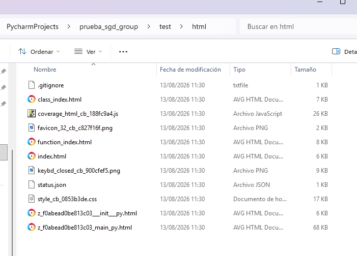

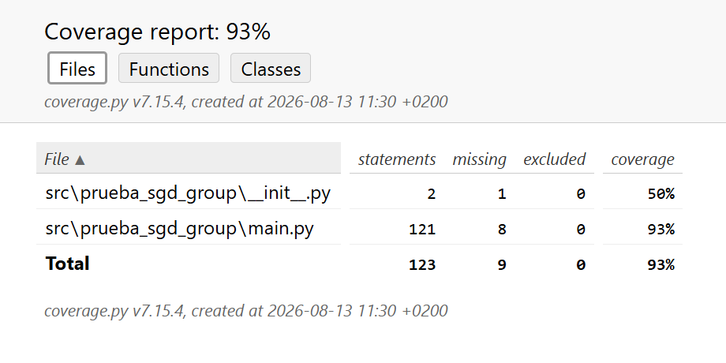

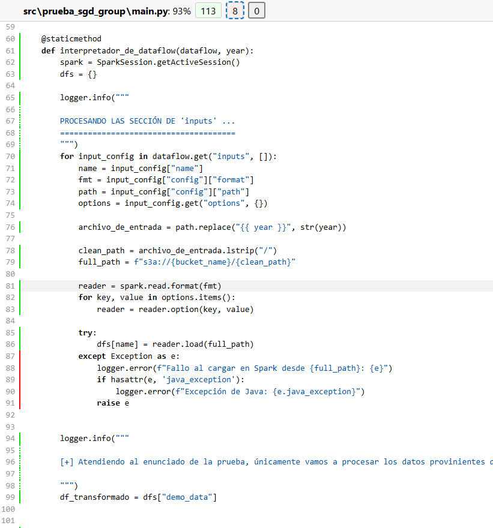


# Infraestructura as code y workflows CI / CD

Añadimos infrastructura como código con Terraform y github workflows CI/CD:   

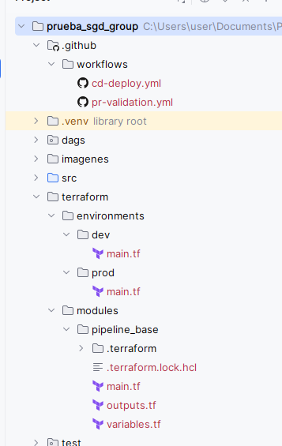

Validamos los archivos de terraform sin conectar con el entorno de AWS:

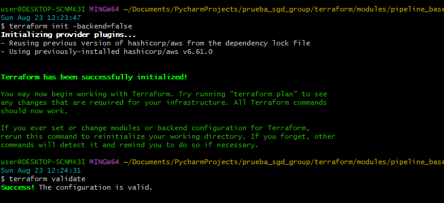

Si vamos al proyecto en Github podremos ver los workflows en la sección de Actions:

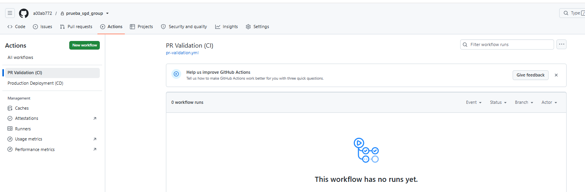
